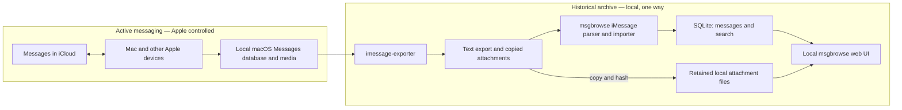

# Permanent offline iMessage archive: architecture

This is the architecture reference for this fork's iMessage archival behavior. The existing [upstream architecture](../ARCHITECTURE.md) describes msgbrowse as a whole. The Stage 1 assessment was based on commit `043562ae667e1fbc01b9c5609a49db8b12625eaf`; Stage 2 adds code and synthetic tests. No real Messages library has been validated yet.

## Purpose and scope

Apple Messages with Messages in iCloud remains the active messaging system. This fork aims to retain a searchable, local history after a user deletes selected older messages from Apple Messages to reduce iCloud storage. The archive must survive source deletion and remain usable offline. Repeated ingestion must add new content without removing earlier archived content.

This project reuses msgbrowse's Go application, SQLite store, web UI, and exporter integration. It does not sync data back to Apple Messages, replace active messaging, implement archive deletion, require a subscription, or introduce a new database or service. The Stage 2 code retains imported rows and media in synthetic tests; real-history completeness, exporter compatibility, and disaster recovery still need validation. Do not delete anything from iCloud on the strength of synthetic tests alone.

## System architecture



**Current:** `msgbrowse export` invokes `imessage-exporter -f txt -c clone -o <imessage_archive_root>`; msgbrowse itself does not open `chat.db` ([`internal/cli/export.go`](../internal/cli/export.go), `exportIMessage`). The importer scans top-level `<ChatName>.txt` files, preserves legacy attachment references before source replacement, copies available media to permanent storage, and inserts newly observed messages without deleting old rows ([`internal/imessage/import.go`](../internal/imessage/import.go), `Run` and `importConversation`; [`internal/imessage/media.go`](../internal/imessage/media.go); [`internal/store/imessage_archive.go`](../internal/store/imessage_archive.go)). The Providers flow still exports into staging and swaps the managed export root, but retains referenced media first ([`internal/onboard/runner.go`](../internal/onboard/runner.go), `execute`; [`internal/onboardsvc/onboardsvc.go`](../internal/onboardsvc/onboardsvc.go), `PreserveBeforeReplacement`).

**Target beyond Stage 2:** Validate the importer against actual Apple Messages exports, prove recovery from a complete backup, and establish a safe manual deletion procedure. Message GUID support and identity ambiguity remain open; source deletions must never travel back into the historical archive.

Other msgbrowse sources (Signal, WhatsApp) share the store's replacement method. Scope iMessage retention changes explicitly so their existing behavior is not changed accidentally ([`internal/ingest/ingest.go`](../internal/ingest/ingest.go), line 242; [`internal/whatsapp/import.go`](../internal/whatsapp/import.go), line 170).

## Data model and storage

The CLI creates `<data_dir>/msgbrowse.sqlite`; `data_dir` defaults to `./data`. `openStore` creates the directory, and `store.Open` enables WAL, foreign keys, and migrations ([`internal/cli/common.go`](../internal/cli/common.go), lines 16–30; [`internal/config/config.go`](../internal/config/config.go), line 337; [`internal/store/store.go`](../internal/store/store.go), lines 23–67). The database is ordinary SQLite using the pure-Go `modernc.org/sqlite` driver ([`go.mod`](../go.mod), line 21). Schema version is 24 at this assessment ([`internal/store/schema.go`](../internal/store/schema.go), lines 5–66).

| Entity | Current identity and relationship |
| --- | --- |
| Conversation | `conversations.id`; unique `(source, name)`. For iMessage, `name` comes from the export filename. Contact identity is derived from that name by `UpsertConversation`; a renamed or reallocated export file may be treated as a different conversation. ([`internal/imessage/import.go`](../internal/imessage/import.go), lines 83–88 and 153–156; [`internal/store/store.go`](../internal/store/store.go), lines 132–163; [`internal/store/schema.go`](../internal/store/schema.go), lines 188–199.) |
| Message | `messages.id` is a SQLite row ID; globally unique `messages.hash` is SHA-256 of source, conversation name, normalized second-resolution timestamp, sender, body, and a per-identical-tuple occurrence sequence. Attachment paths and reactions are **not** included. No Apple message GUID is carried by the current parsed model or stored schema. ([`internal/signal/message.go`](../internal/signal/message.go), lines 70–133; [`internal/imessage/parser.go`](../internal/imessage/parser.go), lines 149–159, 249–266, 277–288; [`internal/store/schema.go`](../internal/store/schema.go), lines 77–87.) |
| Attachment | `attachments.message_id` references a message with `ON DELETE CASCADE`; rows store kind, relative path, and original name, **not file bytes**. iMessage text attachment lines are recognized by a path/extension heuristic. ([`internal/store/schema.go`](../internal/store/schema.go), lines 92–99; [`internal/imessage/parser.go`](../internal/imessage/parser.go), lines 58–76 and 221–244.) |
| Link and reaction | Links cascade with messages. Reactions use message hash and `(message_hash, emoji, actor)` uniqueness; iMessage tapbacks are parsed as reaction data on a message, not standalone messages. ([`internal/store/store.go`](../internal/store/store.go), lines 332–400; [`internal/imessage/parser.go`](../internal/imessage/parser.go), lines 93–127 and 188–201.) |
| Search and metadata | FTS5 `messages_fts` is maintained by message insert/delete/update triggers. `ingest_state` tracks a conversation's export file mtime, size, content hash, and last count; `ingest_runs` holds run summaries. Embeddings are optional and keyed by message hash. ([`internal/store/schema.go`](../internal/store/schema.go), lines 120–159 and 222–244.) |

For CLI exports, `imessage_archive_root` contains text files and a copied `attachments/` tree. On the Providers path, the app-managed root is `<data_dir>/archives/imessage` ([`internal/setup/layout.go`](../internal/setup/layout.go), `ManagedRoot`). The importer streams each referenced regular file under the export root into `<data_dir>/media/imessage/<first-two-SHA256-hex>/<SHA256><lowercase-extension>`. It creates files without overwriting an existing copy and verifies an existing file's hash. SQLite stores `permanent/<first-two-hex>/<SHA256><extension>`; [`internal/archivepath/archivepath.go`](../internal/archivepath/archivepath.go), `Resolve`, maps that namespace to retained storage. Unchanged bytes and extension share one file across messages. Export paths remain read-only input. Missing new media fails that conversation's import; a previously retained attachment can survive a later missing source file. Existing pre-Stage-2 attachment references are copied and redirected when their source bytes are still available. If those bytes were already lost, their historical contents cannot be reconstructed or verified.

The Backups feature uses `VACUUM INTO` for the SQLite DB and now copies retained iMessage media into each snapshot, listing checksums for every file in its manifest. Restore verifies checksums and restores missing media before swapping in the snapshot DB; it leaves newer retained files intact ([`internal/backup/manager.go`](../internal/backup/manager.go), `Create`, `Restore`, `copyRetainedMedia`, `restoreRetainedMedia`). Older snapshots made before Stage 2 may contain only the DB and config. Restore them only after separately verifying that all referenced media still exists.

## Data retention policy

| Source event | Required target behavior | Current behavior |
| --- | --- | --- |
| New message | Insert once | Source-scoped hash with `ON CONFLICT DO NOTHING`; newly observed attachment and reaction rows are appended. |
| Unchanged repeated import | Skip without duplication | Export file content hash skips unchanged text; `--full` reparses and insert is idempotent. |
| Message or conversation removed from source | Keep archived rows and media | Missing messages are never deleted; a missing conversation file is not scanned. |
| Attachment removed from source | Keep archived bytes and reference | Existing retained copy and SQLite reference remain. |
| Edited source message | Preserve previously archived content | Changed body has a new hash; both observed versions remain. The exporter may not expose every edit revision. |
| Reaction changed | Do not lose prior message content | Newly observed reactions append; older reaction observations remain. |

The iMessage importer calls `AppendIMessageMessages`, which preserves existing rows and their FTS entries and adds new rows in a transaction. Signal and WhatsApp continue calling `ReplaceConversationMessages`, whose delete/reinsert semantics are unchanged ([`internal/store/store.go`](../internal/store/store.go), `ReplaceConversationMessages`). A changed text export is hashed even if its mtime and byte size are unchanged. If attachment bytes change while the text export is identical, a normal import skips it; `imessage-import --full` re-examines attachments and can retain the newly observed bytes.

Providers no longer renders Disable for iMessage. A crafted Disable request is rejected with HTTP 409, and `DeleteSourceData` independently refuses iMessage; other sources retain their existing Disable behavior ([`internal/web/disable.go`](../internal/web/disable.go); [`internal/store/sources.go`](../internal/store/sources.go)). Source-driven deletion of archived messages or attachments is prohibited. Normal index, metadata, and backup maintenance may continue.

**Identity strategy and limits:** The existing hash of `(source, export conversation name, normalized second-resolution timestamp, sender, body, occurrence sequence)` is retained. The text records consumed here do not carry an Apple message GUID, although the exporter works from a database that has GUID fields ([exporter diagnostics](https://github.com/ReagentX/imessage-exporter/blob/develop/docs/diagnostics.md)). Reordering different messages preserves their hashes; byte-identical messages within a conversation get distinct sequence numbers. Deletion and later addition of otherwise identical messages can reuse an occurrence number and be mistaken for a prior message. A renamed group export file can create a second conversation. Attachment-only messages with the same sender/time can also be ambiguous because attachment paths are not in the hash. An edit creates a new hash and preserves the old content, but cannot be linked conclusively to its prior version. These are unresolved until a supported export format yields stable source IDs or real-history validation establishes a safer matching rule. Do not claim lossless identity for these cases.

## Operational lifecycle

This is a validation workflow for the implementation, not yet a safe instruction to reduce iCloud content:

1. Ensure the desired messages and full attachment originals are downloaded to the Mac; verify this outside msgbrowse as well as through exporter diagnostics.
2. Export from the local Messages database with `imessage-exporter` in copy mode. Full Disk Access may be required for the terminal or app running it.
3. Import into msgbrowse's SQLite store and independently retained media storage. Resolve every import error before relying on the result.
4. Verify expected conversations and counts, sample search results and open every required attachment class, and run integrity checks. The current `doctor` samples image attachment paths; it is not a complete archival verification ([`internal/cli/doctor.go`](../internal/cli/doctor.go), lines 377–421).
5. Create a new-format backup of **both** the SQLite database and retained attachment files, then verify restore on a separate copy. Older DB-only snapshots do not cover media.
6. **Only after verification and backup**, remove selected historical items from Apple Messages/iCloud, following a separately validated procedure. This action is irreversible across synced devices and is outside Stage 1.
7. Repeat export and import periodically to capture new content; recheck retention and backup integrity before any further source deletion.

Do not begin step 6 until real-history completeness, unresolved identity cases, attachment integrity, and recovery have been verified.

## Build and offline operation

The core CLI requires the Go toolchain specified in [`go.mod`](../go.mod) (`go 1.25.8`, `toolchain go1.27.0`); dependencies must be available locally or downloaded once for a build. `make build` builds `./bin/msgbrowse` with `CGO_ENABLED=0`, including on macOS arm64 ([`Makefile`](../Makefile), lines 39–46 and 64–73). `imessage-exporter` is required to create a fresh iMessage export, but not to browse an already populated store and present media tree. The desktop shell is a separate Wails/cgo module; the core CLI path avoids those dependencies ([`Makefile`](../Makefile), lines 47–58).

```sh
make build
brew install imessage-exporter   # only if you need to produce a fresh iMessage export
./bin/msgbrowse --data-dir ./data --imessage-archive-root /absolute/path/to/imessage-export doctor
./bin/msgbrowse --data-dir ./data --imessage-archive-root /absolute/path/to/imessage-export imessage-import
./bin/msgbrowse --data-dir ./data --imessage-archive-root /absolute/path/to/imessage-export serve
```

To generate an export with the existing CLI, set an iMessage root and run `./bin/msgbrowse --imessage-archive-root /absolute/path/to/imessage-export export`; it invokes copy mode. Use a disposable or separately backed-up export location for validation. Do not point it at irreplaceable historical media while the exporter's overwrite behavior remains unverified. Keyword search and browsing do not need an LLM or network. Optional AI features require a configured endpoint; the exporter is a separate subprocess, so its own behavior and permissions must be assessed. A completed local archive can operate offline only if its DB and every referenced media file are present.

## Design principles

- Reuse msgbrowse's parser, store, UI, and existing workflow; make the smallest targeted changes.
- Preserve upstream compatibility where practical and keep other sources' semantics explicit.
- Prefer SQLite and ordinary local files; avoid subscriptions, cloud dependencies, and unneeded services, databases, frameworks, or intermediary applications.
- Prioritize data preservation over ingestion convenience. Never let a source deletion remove archived content.
- Make repeated imports safe and idempotent, including after a partial failure.
- Treat source exports as replaceable input and the historical archive as independently retained output.

## Risks and limitations

| Risk | Evidence and required validation |
| --- | --- |
| Apple/macOS or exporter format change | Parser targets `imessage-exporter` 4.2.0 text layout ([`internal/imessage/parser.go`](../internal/imessage/parser.go), lines 1–28). Validate against real exports and each upgrade. |
| Missing local downloads | `clone` can only preserve files the exporter can access. Confirm actual bytes and sizes; parser can classify a missing-attachment notice as non-content ([`internal/imessage/parser.go`](../internal/imessage/parser.go), lines 84–91). |
| Identity and edits | Text model lacks GUIDs; content hashes change with body or conversation name. Test edited messages, duplicate tuples, groups, timestamp ties, export ordering, and reactions before choosing identity. |
| Attachment integrity | Legacy references may already outlive their original bytes. The importer verifies retained bytes when copying; validate actual attachment classes and sizes on real history. |
| SQLite corruption and recovery | WAL database needs a consistent backup. New snapshots include DB, config, and retained iMessage media; perform a restore drill on a separate copy. Older snapshots may lack media. |
| macOS and upstream maintenance | Full Disk Access, exporter availability, text format, and Go/Wails dependencies can change. Keep format fixtures and a tested offline build path; do not assume continued upstream updates. |

## Implementation status

“Tested (synthetic)” means regression tests use fabricated exports and media. No real Mac archive has been validated.

| Capability | Current behavior | Target behavior | Status |
| --- | --- | --- | --- |
| Local SQLite and keyword search | Store, FTS5 triggers, web UI exist | Reuse | Implemented |
| iMessage text export/import | CLI invokes copy-mode exporter; parser imports flat text | Reuse with format validation | Implemented |
| Unchanged-export skip | Content hash; `--full` reparses and rechecks media | Keep safe optimization | Tested (synthetic) |
| Append-only messages | Inserts new hashes, retains prior rows and omitted conversations | Preserve existing content | Tested (synthetic) |
| Conversation identity | `(source, export filename)` | Stable across supported export changes | Unverified |
| Apple message GUID | Not carried by text parser/store | Use if available and stable | Unverified |
| Independent attachment retention | Referenced bytes copied to `<data_dir>/media/imessage` with SHA-256 names; legacy references migrate when bytes remain | Preserve verified bytes in archive-owned files | Tested (synthetic) |
| Providers refresh | Preserves legacy references before replacing managed export; append import retains existing rows | Preserve existing media and content | Tested (synthetic) |
| Providers Disable | No iMessage control; request and store deletion guard reject it | Prevent iMessage archive loss | Tested (synthetic) |
| DB backup | New snapshots include DB, config, and retained media checksums | Back up DB plus permanent media | Tested (synthetic) |
| Offline browsing | Local UI/search with existing DB and media | Tested offline archive after source deletion | Unverified |
| Real-history completeness | Fixture-level tests only in assessment | Validate actual counts, media, search, restore | Unverified |

## Architecture decision log

| Decision | Rationale | Alternatives considered | Open question |
| --- | --- | --- | --- |
| D1: Keep msgbrowse and SQLite | Existing parsing, search, UI, migrations, and backups provide a base. | New archive application or DB. | None for Stage 2. |
| D2: One-way local export/import | Separates active iCloud sync from historical retention. | Direct `chat.db` access inside msgbrowse or a sync service. | Verify exporter compatibility and full local download. |
| D3: Retain media independently from export staging | Export roots can be replaced. Content-addressed files under `<data_dir>/media/imessage` are written without overwrite and verified by SHA-256; new backups include them. | Treat copied export root itself as permanent, or store blobs in SQLite. | Validate real attachment coverage and recovery. |
| D4: Preserve existing message rows | iMessage-specific insert-on-conflict preserves rows and FTS entries while retaining the existing content hash. | Continue source-snapshot replacement. | Stable source GUIDs remain unavailable in the consumed text format; validate identity ambiguities. |
| D5: Start with manual verification | iCloud deletion needs evidence of complete retention and recovery. | Immediate scheduled automation. | Define objective completeness checks on real history. |
| D6: Guard destructive provider actions | Refresh first preserves legacy media; Disable is rejected for iMessage in UI, HTTP handler, and store. | Permit a source reset and try to reconstruct history. | Validate upgrade from existing libraries with real, disposable copies. |

### Recommended implementation stages

| Stage | Prerequisites | Anticipated changes | Tests and success criteria |
| --- | --- | --- | --- |
| **2 — Append-only ingestion** | Existing TXT parser and content hash; real-history validation deferred. | Implemented iMessage-specific append path, retained media, refresh/Disable protection, backup coverage, and documentation. | Synthetic tests cover repeated imports, source deletion, edited/identical/group/reordered messages, attachment disappearance, Providers refresh/Disable, search, and restore. Real-history validation remains open. |
| **3 — Historical import and validation** | Stage 2 tests pass; copy of real source and enough disk space. | Import actual history; build counts/media/checksum report and investigate mismatches. | Check representative and aggregate conversation counts, search, attachment access, and offline operation; no unexplained loss. |
| **4 — Repeatable archival workflow** | Validated archive and backups. | Document manual export → import → verify → backup procedure using current commands; automate only after stable operation. | Two or more real cycles yield only new records, preserve old bytes, and restore successfully. |
| **5 — iCloud storage reduction** | Verified complete, independent archive plus tested DB/media backup and restore. | Document a cautious, separately validated Apple Messages deletion procedure. | Selected source deletion leaves archive counts, searches, and media unchanged while active Messages synchronization continues. |

**Next task:** Run Stage 3 against disposable, non-sensitive real exports. Audit message identities, conversation names, attachment counts and bytes, offline search, and a separate-copy restore before relying on the archive for any iCloud deletion decision.
