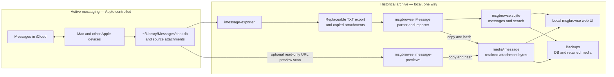

# Permanent offline iMessage archive: architecture

This is the architecture reference for this fork's iMessage archival behavior. The existing [upstream architecture](../ARCHITECTURE.md) describes msgbrowse as a whole. The Stage 1 assessment was based on commit `043562ae667e1fbc01b9c5609a49db8b12625eaf`; Stage 2 adds code and synthetic tests. Stage 3 has validated limited real iMessage and SMS exports; full-history completeness remains unverified.

## Purpose and scope

Apple Messages with Messages in iCloud remains the active messaging system. This fork aims to retain a searchable, local history after a user deletes selected older messages from Apple Messages to reduce iCloud storage. The archive must survive source deletion and remain usable offline. Repeated ingestion must add new content without removing earlier archived content.

This project reuses msgbrowse's Go application, SQLite store, web UI, and exporter integration. It does not sync data back to Apple Messages, replace active messaging, implement archive deletion, require a subscription, or introduce a new database or service. The Stage 2 code retains imported rows and media in synthetic tests; a limited real-data retention and restore drill also passed. Full-history completeness, broader exporter compatibility, and recovery from other failure modes still need validation. Do not delete anything from iCloud on the strength of this limited sample.

## System architecture

[`imessage-exporter`](https://github.com/ReagentX/imessage-exporter) is an
external, read-only exporter. It reads the local Apple Messages database
(`~/Library/Messages/chat.db`) and attachment files, then writes TXT transcripts
and copied attachments. It does **not** create msgbrowse's permanent SQLite
archive. Normal msgbrowse export/import consumes exporter files and does not
open Apple's database. The optional, explicit `imessage-previews` command reads
Apple's database and local preview files in read-only mode to backfill images
omitted by TXT export. msgbrowse identifies newly observed messages, preserves earlier imported
messages, copies attachment bytes into archive-controlled storage, and serves
SQLite-backed search and offline browsing. This flow never writes back to Apple
Messages or iCloud.



The boundary between `Export` and `Ingest` is deliberately one way. A later
export can omit a message deleted from Apple Messages. The importer treats
that omission as absent input for the current pass, not as an instruction to
delete the already archived row or attachment bytes.

Optional iMessage exclusion rules run after TXT parsing and before attachment
retention and `AppendIMessageMessages`. They may omit five or six digit sender
addresses, incoming email-address messages containing `appointment reminder`,
or explicitly named export conversations and phrases. `imessage-import
--preview-exclusions` parses the export and reports aggregate rule counts
without opening the archive database or copying media. The policy is included
in incremental ingest state, so changing rules rescans unchanged TXT files.
Adding an exclusion cannot remove previously archived rows or bytes. Export
staging still contains omitted messages until separately cleaned. Apple's
“Unknown Senders” classification is not present in the parsed TXT record; it
cannot currently be used as an automatic filter. A resolved contact name can
also hide a short code or email address from the address-based rules. No
full-history exclusion accuracy has yet been validated.

**Current:** `msgbrowse export` invokes `imessage-exporter -f txt -c clone -o <imessage_archive_root>`; this normal path does not open `chat.db` ([`internal/cli/export.go`](../internal/cli/export.go), `exportIMessage`). The importer scans top-level `<ChatName>.txt` files, preserves legacy attachment references before source replacement, copies available media to permanent storage, and inserts newly observed messages without deleting old rows ([`internal/imessage/import.go`](../internal/imessage/import.go), `Run` and `importConversation`; [`internal/imessage/media.go`](../internal/imessage/media.go); [`internal/store/imessage_archive.go`](../internal/store/imessage_archive.go)). The Providers flow still exports into staging and swaps the managed export root, but retains referenced media first ([`internal/onboard/runner.go`](../internal/onboard/runner.go), `execute`; [`internal/onboardsvc/onboardsvc.go`](../internal/onboardsvc/onboardsvc.go), `PreserveBeforeReplacement`).

**Target beyond the limited Stage 3 sample:** Validate additional iMessage conversations and full-history completeness, test recovery under more failure modes, and establish a safe manual deletion procedure. Message GUID support and identity ambiguity remain open; source deletions must never travel back into the historical archive.

Other msgbrowse sources (Signal, WhatsApp) share the store's replacement method. Scope iMessage retention changes explicitly so their existing behavior is not changed accidentally ([`internal/ingest/ingest.go`](../internal/ingest/ingest.go), line 242; [`internal/whatsapp/import.go`](../internal/whatsapp/import.go), line 170).

## Data model and storage

The CLI creates `<data_dir>/msgbrowse.sqlite`; `data_dir` defaults to `./data`. `openStore` creates the directory, and `store.Open` enables WAL, foreign keys, and migrations ([`internal/cli/common.go`](../internal/cli/common.go), lines 16–30; [`internal/config/config.go`](../internal/config/config.go), line 337; [`internal/store/store.go`](../internal/store/store.go), lines 23–67). The database is ordinary SQLite using the pure-Go `modernc.org/sqlite` driver ([`go.mod`](../go.mod), line 21). Schema version is 24 at this assessment ([`internal/store/schema.go`](../internal/store/schema.go), lines 5–66).

| Entity | Current identity and relationship |
| --- | --- |
| Conversation | `conversations.id`; unique `(source, name)`. For iMessage, `name` comes from the export filename. Contact identity is derived from that name by `UpsertConversation`; a renamed or reallocated export file may be treated as a different conversation. ([`internal/imessage/import.go`](../internal/imessage/import.go), lines 83–88 and 153–156; [`internal/store/store.go`](../internal/store/store.go), lines 132–163; [`internal/store/schema.go`](../internal/store/schema.go), lines 188–199.) |
| Message | `messages.id` is a SQLite row ID; globally unique `messages.hash` is SHA-256 of source, conversation name, normalized second-resolution timestamp, sender, body, and a per-identical-tuple occurrence sequence. Attachment paths and reactions are **not** included. No Apple message GUID is carried by the current parsed model or stored schema. ([`internal/signal/message.go`](../internal/signal/message.go), lines 70–133; [`internal/imessage/parser.go`](../internal/imessage/parser.go), lines 149–159, 249–266, 277–288; [`internal/store/schema.go`](../internal/store/schema.go), lines 77–87.) |
| Attachment | `attachments.message_id` references a message with `ON DELETE CASCADE`; rows store kind, relative path, and original name, **not file bytes**. iMessage text attachment lines are recognized by a path/extension heuristic. ([`internal/store/schema.go`](../internal/store/schema.go), lines 92–99; [`internal/imessage/parser.go`](../internal/imessage/parser.go), lines 58–76 and 221–244.) |
| Link and reaction | Links cascade with messages. Reactions use message hash and `(message_hash, emoji, actor)` uniqueness; iMessage tapbacks are parsed as reaction data on a message, not standalone messages. ([`internal/store/store.go`](../internal/store/store.go), lines 332–400; [`internal/imessage/parser.go`](../internal/imessage/parser.go), lines 93–127 and 188–201.) |
| Search and metadata | FTS5 `messages_fts` is maintained by message insert/delete/update triggers. `ingest_state` tracks a conversation's export file mtime, size, content hash, and last count; `ingest_runs` holds run summaries. Embeddings are optional and keyed by message hash. ([`internal/store/schema.go`](../internal/store/schema.go), lines 120–159 and 222–244.) |

The paths have distinct owners and lifetimes:

```text
~/Library/Messages/chat.db                 Apple-owned source database; never modified by msgbrowse
~/Library/Messages/Attachments/            Apple-owned source media
<export_dir>/<ChatName>.txt               manual, replaceable TXT export
<export_dir>/attachments/...              manual, replaceable copied attachments
<data_dir>/archives/imessage.staging/...  temporary Providers export while a job runs
<data_dir>/archives/imessage/...          adopted Providers export; still replaceable
<data_dir>/msgbrowse.sqlite               permanent message and search database
<data_dir>/media/imessage/<2-hex>/<sha256><ext>  permanent attachment and URL preview bytes
<data_dir>/derived/<path-hash>.jpg      regenerable HEIC/HEIF/TIFF browser previews
<data_dir>/backups/snapshot-.../...       default snapshot location; configurable
```

For manual CLI exports, `imessage_archive_root` points to `<export_dir>`.
Providers instead runs the exporter into staging and adopts the result under
`<data_dir>/archives/imessage` after success ([`internal/setup/layout.go`](../internal/setup/layout.go),
`ManagedRoot`; [`internal/onboard/runner.go`](../internal/onboard/runner.go),
`execute`). Neither export tree is permanent storage. The importer streams each
referenced regular attachment file into
`<data_dir>/media/imessage/<first-two-SHA256-hex>/<SHA256><lowercase-extension>`.
It creates files without overwriting an existing copy and verifies an existing
file's hash. SQLite stores `permanent/<first-two-hex>/<SHA256><extension>`;
[`internal/archivepath/archivepath.go`](../internal/archivepath/archivepath.go),
`Resolve`, maps that namespace to retained storage. Unchanged bytes and
extension share one file across messages. Export paths remain read-only input.
Missing new media fails that conversation's import; a previously retained,
verified attachment can survive a later missing source file. Existing
pre-Stage-2 attachment references are copied and redirected when their source
bytes are still available. If those bytes were already lost, their historical
contents cannot be reconstructed or verified.

The optional `imessage-previews` command scans `com.apple.messages.URLBalloonProvider`
messages with hidden `.pluginPayloadAttachment` files from Apple's database,
using a read-only SQLite connection. It requires a unique match to an existing
archived link by local timestamp second, direction, and URL host found in Apple
message text or payload data. Zero or multiple matches are skipped and reported.
Supported local PNG, JPEG, and ICO bytes are copied into the same permanent
media tree; SQLite attachment rows mark the card image, extra images, and icons
separately. The card image appears in the transcript, while extra assets are
retained outside the ordinary photo gallery. The full URL remains in the link
target and copy control, but URL-only text lines are hidden in the transcript.
This command does not fetch remote metadata or images and cannot recover files
already removed from the Mac. It does not import otherwise missing messages.
Run it before removing source data and include the retained media in backups.

The Backups feature uses `VACUUM INTO` for the SQLite DB and now copies retained iMessage media into each snapshot, listing checksums for every file in its manifest. Restore verifies checksums and restores missing media before swapping in the snapshot DB; it leaves newer retained files intact ([`internal/backup/manager.go`](../internal/backup/manager.go), `Create`, `Restore`, `copyRetainedMedia`, `restoreRetainedMedia`). Older snapshots made before Stage 2 may contain only the DB and config. Restore them only after separately verifying that all referenced media still exists.

Browsers cannot display original HEIC/HEIF/TIFF files. `imessage-import` now
runs the existing local image converter after importing, producing cached JPEG
derivatives under `<data_dir>/derived`; the gallery and transcript serve these
previews while retaining the original bytes under permanent media. The cache is
not part of a backup and can be rebuilt after restore with `msgbrowse media`.
If no converter is installed or a conversion fails, the UI shows a download
placeholder until conversion succeeds. The limited real sample had four HEIC
originals; running `msgbrowse media` produced four valid JPEG derivatives, and
the local media route returned JPEG with HTTP 200 for a representative image.

### Exporter dependency and completeness

The CLI locates `imessage-exporter` on `PATH` unless
`--imessage-exporter-bin` (for `msgbrowse export`) or
`imessage_exporter_bin` in config specifies a path. The CLI does not install
it. `msgbrowse export` invokes
`imessage-exporter -f txt -c clone -o <imessage_archive_root>`; the standalone
command can be run with those same flags. The `serve` Providers flow uses the
config path or `PATH`, and the desktop app uses its bundled binary. Providers
uses `-f txt -c clone -o <staging_dir>` and imports the adopted result. The
[upstream 4.2.0 binary documentation](https://github.com/ReagentX/imessage-exporter/blob/4.2.0/imessage-exporter/README.md)
defines `clone` as copying attachment files without conversion.

The parser targets the exporter **4.2.0 TXT layout**
([`internal/imessage/parser.go`](../internal/imessage/parser.go)); the desktop
build pins exporter **4.2.0**
([`.github/workflows/desktop.yml`](../.github/workflows/desktop.yml)). Tests
use synthetic text and media. A limited real export made with **5.0.1** also
parsed and imported, but this does not establish general 5.0.1 compatibility
or a supported version range. The CLI has no version pin or runtime version gate. Check a local
binary with `which imessage-exporter` and `imessage-exporter --version`, record
the result, and validate output after changing versions. There is no established
minimum version or verified compatibility range. Pinning a version for a
reproducible archival workflow is advisable **after** validating it on a
disposable real export; a Homebrew install may change with future upgrades.

An exporter failure prevents the Providers staging tree from being adopted;
in a manual workflow, stop on export failure rather than importing a possibly
partial output directory. Success of the exporter alone does not establish
completeness. Attachments absent from the local Mac, including files not fully
downloaded from iCloud, cannot be copied. [Exporter
diagnostics](https://github.com/ReagentX/imessage-exporter/blob/develop/docs/diagnostics.md)
report missing files; msgbrowse's parser can also skip an `Attachment missing!`
notice, while a missing file referenced by a parsed attachment fails that
conversation's import. Compare expected counts and representative media with
the source and resolve every error before relying on the archive.

## Data retention policy

| Source event | Required target behavior | Current behavior |
| --- | --- | --- |
| New message | Insert once | Source-scoped hash with `ON CONFLICT DO NOTHING`; newly observed attachment and reaction rows are appended. |
| Unchanged repeated import | Skip without duplication | Export file content hash skips unchanged text; `--full` reparses and insert is idempotent. |
| Message or conversation removed from source | Keep archived rows and media | Missing messages are never deleted; a missing conversation file is not scanned. |
| Attachment removed from source | Keep archived bytes and reference | Existing retained copy and SQLite reference remain. |
| Edited source message | Preserve previously archived content | Changed body has a new hash; both observed versions remain. The exporter may not expose every edit revision. |
| Reaction changed | Do not lose prior message content | Newly observed reactions append; older reaction observations remain. |

The iMessage importer calls `AppendIMessageMessages`, which preserves existing rows and their FTS entries and adds new rows in a transaction. Signal and WhatsApp continue calling `ReplaceConversationMessages`, whose delete/reinsert semantics are unchanged ([`internal/store/store.go`](../internal/store/store.go), `ReplaceConversationMessages`). A changed text export is hashed even if its mtime and byte size are unchanged. If attachment bytes change while the text export is identical, a normal import skips it; `imessage-import --full` re-examines attachments and can retain the newly observed bytes.

Providers no longer renders Disable for iMessage. A crafted Disable request is rejected with HTTP 409, and `DeleteSourceData` independently refuses iMessage; other sources retain their existing Disable behavior ([`internal/web/disable.go`](../internal/web/disable.go); [`internal/store/sources.go`](../internal/store/sources.go)). Source-driven deletion of archived messages or attachments is prohibited. Normal index, metadata, and backup maintenance may continue.

**Identity strategy and limits:** The existing hash of `(source, export conversation name, normalized second-resolution timestamp, sender, body, occurrence sequence)` is retained. The text records consumed here do not carry an Apple message GUID, although the exporter works from a database that has GUID fields ([exporter diagnostics](https://github.com/ReagentX/imessage-exporter/blob/develop/docs/diagnostics.md)). Reordering different messages preserves their hashes; byte-identical messages within a conversation get distinct sequence numbers. Deletion and later addition of otherwise identical messages can reuse an occurrence number and be mistaken for a prior message. A renamed group export file can create a second conversation. Attachment-only messages with the same sender/time can also be ambiguous because attachment paths are not in the hash. An edit creates a new hash and preserves the old content, but cannot be linked conclusively to its prior version. These are unresolved until a supported export format yields stable source IDs or real-history validation establishes a safer matching rule. Do not claim lossless identity for these cases.

## Operational lifecycle

This is a validation workflow for the implementation, not yet a safe instruction to reduce iCloud content:

1. Ensure the desired messages and full attachment originals are downloaded to the Mac; verify this outside msgbrowse as well as through exporter diagnostics.
2. Export from the local Messages database with `imessage-exporter` in copy mode. Full Disk Access may be required for the terminal or app running it.
3. Import into msgbrowse's SQLite store and independently retained media storage. Resolve every import error before relying on the result.
4. Verify expected conversations and counts, sample search results and open every required attachment class, and run integrity checks. The current `doctor` samples image attachment paths; it is not a complete archival verification ([`internal/cli/doctor.go`](../internal/cli/doctor.go), lines 377–421).
5. Create a new-format backup of **both** the SQLite database and retained attachment files, then verify restore on a separate copy. Older DB-only snapshots do not cover media.
6. **Only after verification and backup**, remove selected historical items from Apple Messages/iCloud, following a separately validated procedure. This action is irreversible across synced devices and is outside Stage 2.
7. Repeat export and import periodically to capture new content; recheck retention and backup integrity before any further source deletion.

Do not begin step 6 until real-history completeness, unresolved identity cases, attachment integrity, and recovery have been verified.

## Build and offline operation

The core CLI requires the Go toolchain specified in [`go.mod`](../go.mod) (`go 1.25.8`, `toolchain go1.27.0`); dependencies must be available locally or downloaded once for a build. `make build` builds `./bin/msgbrowse` with `CGO_ENABLED=0`, including on macOS arm64 ([`Makefile`](../Makefile), lines 39–46 and 64–73). `imessage-exporter` is required to create a fresh iMessage export, but not to browse an already populated store and present media tree. The desktop shell is a separate Wails/cgo module; the core CLI path avoids those dependencies ([`Makefile`](../Makefile), lines 47–58).

```sh
make build
brew install imessage-exporter   # only if you need to produce a fresh iMessage export
./bin/msgbrowse --data-dir ./data --imessage-archive-root /absolute/path/to/imessage-export imessage-import
./bin/msgbrowse --data-dir ./data --imessage-archive-root /absolute/path/to/imessage-export doctor
./bin/msgbrowse --data-dir ./data --imessage-archive-root /absolute/path/to/imessage-export serve
```

To generate an export with the existing CLI, set an iMessage root and run `./bin/msgbrowse --imessage-archive-root /absolute/path/to/imessage-export export`; it invokes copy mode. Use a disposable or separately backed-up export location for validation. Do not point it at irreplaceable historical media while the exporter's overwrite behavior remains unverified. Keyword search and browsing do not need an LLM or network. Optional AI features require a configured endpoint; the exporter is a separate subprocess, so its own behavior and permissions must be assessed. A completed local archive can operate offline only if its DB and every referenced media file are present.

## Design principles

- Reuse msgbrowse's parser, store, UI, and existing workflow; make the smallest targeted changes.
- Preserve upstream compatibility where practical and keep other sources' semantics explicit.
- Prefer SQLite and ordinary local files; avoid subscriptions, cloud dependencies, and unneeded services, databases, frameworks, or intermediary applications.
- Prioritize data preservation over ingestion convenience. Never let a source deletion remove archived content.
- Make repeated imports safe and idempotent, including after a partial failure.
- Treat source exports as replaceable input and the historical archive as independently retained output.

## Risks and limitations

| Risk | Evidence and required validation |
| --- | --- |
| Apple/macOS or exporter format change | Parser targets `imessage-exporter` 4.2.0 text layout ([`internal/imessage/parser.go`](../internal/imessage/parser.go), lines 1–28). Validate against real exports and each upgrade. |
| Missing local downloads | `clone` can only preserve files the exporter can access. Confirm actual bytes and sizes; parser can classify a missing-attachment notice as non-content ([`internal/imessage/parser.go`](../internal/imessage/parser.go), lines 84–91). |
| Identity and edits | Text model lacks GUIDs; content hashes change with body or conversation name. Test edited messages, duplicate tuples, groups, timestamp ties, export ordering, and reactions before choosing identity. |
| Attachment integrity | Legacy references may already outlive their original bytes. The importer verifies retained bytes when copying; validate actual attachment classes and sizes on real history. The 11 omitted hidden rows in the Stage 3 sample were URL preview payloads; the optional backfill now retains their bytes in this sample. Do not treat `hide_attachment` alone as proof that a file can be excluded in other conversations. |
| URL preview matching | TXT exports lack source GUIDs and omit thumbnail files. The optional scan requires a unique timestamp, direction, and URL-host match. Timestamp ties, absent URL metadata, unsupported file types, or unavailable local files require manual review. No remote image fetching is performed. |
| SQLite corruption and recovery | WAL database needs a consistent backup. New snapshots include DB, config, and retained iMessage media; perform a restore drill on a separate copy. Older snapshots may lack media. |
| macOS and upstream maintenance | Full Disk Access, exporter availability, text format, and Go/Wails dependencies can change. Keep format fixtures and a tested offline build path; do not assume continued upstream updates. |

## Limited Stage 3 real-data validation (2026-11-06)

Approved, isolated exports covered 2026-10-20 through 2026-11-05 using
`imessage-exporter` 5.0.1. One participant filter matched after removing
phone punctuation. A second phone number was corrected by the user and then
matched; the originally supplied digits and the confirmed email had no exact
matching handle in the local Messages database. The corrected phone export
contained 15 messages, and a read-only query of Apple's chat metadata counted
five RCS and ten SMS messages for that handle in the selected window. The first
participant's selected chats contained 106 iMessage messages, 14 SMS messages,
and nine iMessage reaction rows. The exporter's 120 timestamped messages and
msgbrowse's 120 message rows plus nine reaction rows match those source
categories. Daily counts for the 120 source message rows and 120 exported
timestamp headers also match across the window. This provides limited real
iMessage-transport coverage, although TXT does not carry stable source GUIDs
for per-message identity matching. No personal message text or participant
identifiers were recorded in this report.

The exporter read Apple's database without modifying it. msgbrowse imported
disposable byte-for-byte copies into a separate archive. The first import
produced 120 messages, five conversations (four individual and one group with
six real messages), and ten retained attachments. The message count matched
the 120 timestamp headers in those transcripts; messages spanned 14 dates
within the selected window. The attachments comprised HEIC, MOV, PNG, GIF,
and VCF files. A read-only source audit found 21 attachment rows associated
with iMessage-service messages in the selected chats: ten visible and eleven
marked hidden by Apple. All 21 source files were present locally. The ten
visible source hashes matched the ten copied exporter files exactly. All
eleven hidden rows had the `.pluginPayloadAttachment` extension and belonged
to four `com.apple.messages.URLBalloonProvider` messages. They represented
eight distinct hashes and 644,528 bytes; none appeared in the export. Each
of the four source timestamps had a URL-bearing TXT block and no attachment
path. This timestamp match is evidence that the links were rendered, though
TXT lacks GUIDs for a definitive per-message match. Exporter 5.0.1 describes
`hide_attachment` as a [Messages UI flag](https://github.com/ReagentX/imessage-exporter/blob/5.0.1/imessage-database/src/tables/attachment.rs#L164-L170)
and [renders URL balloons](https://github.com/ReagentX/imessage-exporter/blob/5.0.1/imessage-exporter/src/exporters/txt/balloons.rs#L44-L53)
from URL data; the [TXT attachment renderer](https://github.com/ReagentX/imessage-exporter/blob/5.0.1/imessage-exporter/src/exporters/txt/mod.rs#L218-L268)
uses attachment ranges in the message body. For this sample, the omitted files are auxiliary link-preview
payloads, not missing user-visible attachments. The initial archive did not
retain these cache bytes; the optional preview backfill described below does.
A second clean archive imported those 120 messages and then added all 15
messages from the corrected phone export, yielding 135 distinct messages in
six conversations and the same ten attachments. There were no
exporter `Attachment missing!` notices in either sample, and all ten SQLite
references for exported attachments resolved to archive-owned files whose
SHA-256 hashes matched the copied source files. Repeated imports added zero messages.
Keyword search returned real-message hits, and the chronological query
returned nondecreasing timestamps.

A second, independent `imessage-exporter` 5.0.1 run used the same participant
filters and date window in a new isolated export directory. Its seven TXT
transcripts and ten copied files had the same relative paths and SHA-256
checksums as the first exports; the timestamp-header counts were again 120
and 15. A consistent SQLite copy of the clean 135-message archive was placed
in a disposable directory. Running `imessage-import --full` against both new
exports forced parsing and insertion checks rather than relying on the
unchanged-file shortcut. Both imports added zero messages. The copied archive
still had the same 135 message hashes, six conversations, nine reactions, and
ten media hashes, and passed `PRAGMA integrity_check`. This validates one
independent repeat export with the same exporter version and source window;
it does not prove identity stability after contact renames, edits, exporter
upgrades, or timezone changes.

In the disposable export only, one message with an attachment and one entire
conversation transcript were removed, along with the selected source media
file. Reimport added zero messages and retained all 120 prior message hashes,
all five conversations, and all ten archived media checksums. Adding one
synthetic message to that disposable export added exactly one archive row and
one searchable result; repeating the import added zero duplicates. This tests
source omission, not deletion from Apple Messages or iCloud.

`msgbrowse backups create` made a snapshot containing the SQLite database,
manifest, configuration, and ten retained media files. A byte-identical copy
of the snapshot was restored over a disposable database in a separate
directory. The restored database passed `PRAGMA integrity_check`, contained
121 messages, five conversations, and ten valid attachment references, and
returned the synthetic search result. With the exporter absent from `PATH`,
the restored loopback browser served its home and search pages and returned
all ten media files with the expected checksums across all five file types.
`msgbrowse doctor` exited successfully with no problem checks; its warnings
reflected unconfigured optional archive roots and exporters in the isolated
restore setup.

A second snapshot of the clean 135-message combined archive was copied and
restored into another separate directory. The restored database passed
`PRAGMA integrity_check`, retained the same 135 message hashes and ten media
checksums as the source archive, and had six conversations and ten valid media
references. Without the exporter on `PATH`, its local browser returned the
home page, a real-message search result, and a media file with the expected
checksum.

After identifying the hidden files, a scoped, read-only preview scan matched
all four URL balloon messages to one archived link each by local second,
direction, and URL host. One source message had no plain-text URL, so its host
was found in Apple's payload data. The scan retained eleven image references
(six PNG, four JPEG, one ICO) representing eight distinct SHA-256 files and
644,528 bytes. A repeat scan with the rebuilt command matched the same four
messages and eleven assets, reported no missing or ambiguous matches, and
added zero references. A new snapshot was restored into a separate disposable
directory; source and restored databases both passed SQLite integrity checks,
held 135 iMessage rows and six conversations, and had eleven preview references
resolving to eight hash-verified files. This sample does not
prove unique matching across full history or coverage for other balloon types.

These samples do **not** establish full-history completeness, behavior for
unavailable iCloud downloads, stability under renamed contacts or duplicate
source messages, or safety of deleting Apple/iCloud data. Other hidden
attachment types may need retention; classify them by type and context rather
than by `hide_attachment` alone. The TXT export lacks Apple message GUIDs.
Compare complete
source/export/archive counts and all required media across the full history
before relying on the archive for storage reduction.

## Implementation status

“Tested (synthetic)” means regression tests use fabricated exports and media.
“Tested (limited real sample)” refers only to the isolated participant-filtered
exports and restore drill described above. Apple's metadata confirms iMessage
transport for part of the first sample.

| Capability | Current behavior | Target behavior | Status |
| --- | --- | --- | --- |
| Local SQLite and keyword search | Store, FTS5 triggers, web UI exist | Reuse | Implemented |
| iMessage text export/import | CLI invokes copy-mode exporter; parser imports flat text | Reuse with format validation | Implemented |
| Unchanged-export skip | Content hash; `--full` reparses and rechecks media | Keep safe optimization | Tested (limited real sample) |
| Independent repeat export | Fresh export matched original paths and bytes; forced reimport added zero messages | Avoid duplicates across export cycles | Tested (limited real sample; same exporter version and date window) |
| Append-only messages | Inserts new hashes, retains prior rows and omitted conversations | Preserve existing content | Tested (limited real sample) |
| Conversation identity | `(source, export filename)` | Stable across supported export changes | Unverified |
| Apple message GUID | Not carried by text parser/store | Use if available and stable | Unverified |
| Independent attachment retention | Referenced bytes copied to `<data_dir>/media/imessage` with SHA-256 names; legacy references migrate when bytes remain | Preserve verified bytes in archive-owned files | Tested (limited real sample) |
| HEIC browser previews | `imessage-import` runs the existing local converter; `msgbrowse media` rebuilds JPEG cache after restore | Show HEIC images in gallery and transcript while retaining originals | Tested (limited real sample; four local HEIC files) |
| URL preview retention | Optional read-only source scan copies uniquely matched URL balloon images to permanent media; transcript hides raw URL text and displays the local card image | Preserve link thumbnails independently of Apple-owned caches | Tested (limited real sample; full-history coverage unverified) |
| Providers refresh | Preserves legacy references before replacing managed export; append import retains existing rows | Preserve existing media and content | Tested (synthetic) |
| Providers Disable | No iMessage control; request and store deletion guard reject it | Prevent iMessage archive loss | Tested (synthetic) |
| DB backup | New snapshots include DB, config, and retained media checksums | Back up DB plus permanent media | Tested (limited real sample) |
| Offline browsing | Local UI/search with existing DB and media | Tested offline archive after source deletion | Tested (limited real sample; disposable source omission) |
| Real-history completeness | Two limited participant-filtered samples; the first includes 106 iMessage messages and nine reactions, while the corrected phone's 15 messages were RCS/SMS | Validate actual counts, media, search, restore across full history and iMessage conversations | Unverified |

## Architecture decision log

| Decision | Rationale | Alternatives considered | Open question |
| --- | --- | --- | --- |
| D1: Keep msgbrowse and SQLite | Existing parsing, search, UI, migrations, and backups provide a base. | New archive application or DB. | None for Stage 2. |
| D2: One-way local export/import | Separates active iCloud sync from historical retention. The optional preview backfill reads `chat.db` read-only and never syncs changes back. | A sync service. | Verify exporter compatibility and full local download. |
| D3: Retain media independently from export staging | Export roots can be replaced. Content-addressed files under `<data_dir>/media/imessage` are written without overwrite and verified by SHA-256; new backups include them. | Treat copied export root itself as permanent, or store blobs in SQLite. | Validate real attachment coverage and recovery. |
| D4: Preserve existing message rows | iMessage-specific insert-on-conflict preserves rows and FTS entries while retaining the existing content hash. | Continue source-snapshot replacement. | Stable source GUIDs remain unavailable in the consumed text format; validate identity ambiguities. |
| D5: Start with manual verification | iCloud deletion needs evidence of complete retention and recovery. | Immediate scheduled automation. | Define objective completeness checks on real history. |
| D6: Guard destructive provider actions | Refresh first preserves legacy media; Disable is rejected for iMessage in UI, HTTP handler, and store. | Permit a source reset and try to reconstruct history. | Validate upgrade from existing libraries with real, disposable copies. |

### Recommended implementation stages

| Stage | Prerequisites | Anticipated changes | Tests and success criteria |
| --- | --- | --- | --- |
| **2 — Append-only ingestion** | Existing TXT parser and content hash; real-history validation deferred. | Implemented iMessage-specific append path, retained media, refresh/Disable protection, backup coverage, and documentation. | Synthetic tests cover repeated imports, source deletion, edited/identical/group/reordered messages, attachment disappearance, Providers refresh/Disable, search, and restore. Real-history validation remains open. |
| **3 — Historical import and validation** | Stage 2 tests pass; copy of real source and enough disk space. | Import actual history; build counts/media/checksum report and investigate mismatches. | Check representative and aggregate conversation counts, search, attachment access, and offline operation; no unexplained loss. |
| **4 — Repeatable archival workflow** | Validated archive and backups. | Document manual export → import → verify → backup procedure using current commands; automate only after stable operation. | Two or more real cycles yield only new records, preserve old bytes, and restore successfully. |
| **5 — iCloud storage reduction** | Verified complete, independent archive plus tested DB/media backup and restore. | Document a cautious, separately validated Apple Messages deletion procedure. | Selected source deletion leaves archive counts, searches, and media unchanged while active Messages synchronization continues. |

**Next task:** Compare source, export, and archive counts and media across the full history, investigate any discrepancies, and test more identity edge cases before relying on the archive. Keep Apple Messages/iCloud unchanged until complete-history and recovery checks pass.
