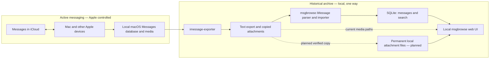

# Permanent offline iMessage archive: architecture

This is the architecture reference for this fork's **intended iMessage archival behavior**. The existing [upstream architecture](../ARCHITECTURE.md) describes msgbrowse as a whole. References below point to source code in this checkout; “current” means verified from code at assessment commit `043562ae667e1fbc01b9c5609a49db8b12625eaf`, not validated on a real Messages library.

## Purpose and scope

Apple Messages with Messages in iCloud remains the active messaging system. This fork aims to retain a searchable, local history after a user deletes selected older messages from Apple Messages to reduce iCloud storage. The archive must survive source deletion and remain usable offline. Repeated ingestion must add new content without removing earlier archived content.

This project reuses msgbrowse's Go application, SQLite store, web UI, and exporter integration. It does not sync data back to Apple Messages, replace active messaging, implement archive deletion, require a subscription, or introduce a new database or service. The current code **does not yet meet** permanent retention requirements. Do not delete anything from iCloud on the strength of the current importer.

## System architecture



**Current:** `msgbrowse export` invokes `imessage-exporter -f txt -c clone -o <imessage_archive_root>`; msgbrowse itself does not open `chat.db` ([`internal/cli/export.go`](../internal/cli/export.go), `exportIMessage`, lines 276–285). The CLI import scans top-level `<ChatName>.txt` files and parses them into the shared message model ([`internal/imessage/import.go`](../internal/imessage/import.go), `Run`, lines 38–107). The optional Providers flow exports to staging, swaps it into an app-managed root, then calls the same importer ([`internal/onboard/runner.go`](../internal/onboard/runner.go), `execute`, lines 405–413 and 545–568; [`internal/onboardsvc/onboardsvc.go`](../internal/onboardsvc/onboardsvc.go), lines 179–205). It is a *source snapshot refresh*, not append-only retention.

**Target:** Keep the one-way export/import path and existing UI. Insert only new iMessage records into SQLite; retain earlier records and attachments when later exports omit or change them. Store attachment bytes in a stable archive-controlled location, separate from any replaceable export staging tree. Source deletions must not travel through either pipeline into the historical archive. The exact file layout and identity migration are Stage 2 decisions.

Other msgbrowse sources (Signal, WhatsApp) share the store's replacement method. Scope iMessage retention changes explicitly so their existing behavior is not changed accidentally ([`internal/ingest/ingest.go`](../internal/ingest/ingest.go), line 242; [`internal/whatsapp/import.go`](../internal/whatsapp/import.go), line 170).

## Data model and storage

The CLI creates `<data_dir>/msgbrowse.sqlite`; `data_dir` defaults to `./data`. `openStore` creates the directory, and `store.Open` enables WAL, foreign keys, and migrations ([`internal/cli/common.go`](../internal/cli/common.go), lines 16–30; [`internal/config/config.go`](../internal/config/config.go), line 337; [`internal/store/store.go`](../internal/store/store.go), lines 23–67). The database is ordinary SQLite using the pure-Go `modernc.org/sqlite` driver ([`go.mod`](../go.mod), line 21). Schema version is 24 at this assessment ([`internal/store/schema.go`](../internal/store/schema.go), lines 5–66).

| Entity | Current identity and relationship |
| --- | --- |
| Conversation | `conversations.id`; unique `(source, name)`. For iMessage, `name` comes from the export filename. Contact identity is derived from that name by `UpsertConversation`; a renamed or reallocated export file may be treated as a different conversation. ([`internal/imessage/import.go`](../internal/imessage/import.go), lines 83–88 and 153–156; [`internal/store/store.go`](../internal/store/store.go), lines 132–163; [`internal/store/schema.go`](../internal/store/schema.go), lines 188–199.) |
| Message | `messages.id` is a SQLite row ID; globally unique `messages.hash` is SHA-256 of source, conversation name, normalized second-resolution timestamp, sender, body, and a per-identical-tuple occurrence sequence. Attachment paths and reactions are **not** included. No Apple message GUID is carried by the current parsed model or stored schema. ([`internal/signal/message.go`](../internal/signal/message.go), lines 70–133; [`internal/imessage/parser.go`](../internal/imessage/parser.go), lines 149–159, 249–266, 277–288; [`internal/store/schema.go`](../internal/store/schema.go), lines 77–87.) |
| Attachment | `attachments.message_id` references a message with `ON DELETE CASCADE`; rows store kind, relative path, and original name, **not file bytes**. iMessage text attachment lines are recognized by a path/extension heuristic. ([`internal/store/schema.go`](../internal/store/schema.go), lines 92–99; [`internal/imessage/parser.go`](../internal/imessage/parser.go), lines 58–76 and 221–244.) |
| Link and reaction | Links cascade with messages. Reactions use message hash and `(message_hash, emoji, actor)` uniqueness; iMessage tapbacks are parsed as reaction data on a message, not standalone messages. ([`internal/store/store.go`](../internal/store/store.go), lines 332–400; [`internal/imessage/parser.go`](../internal/imessage/parser.go), lines 93–127 and 188–201.) |
| Search and metadata | FTS5 `messages_fts` is maintained by message insert/delete/update triggers. `ingest_state` tracks a conversation's export file mtime, size, content hash, and last count; `ingest_runs` holds run summaries. Embeddings are optional and keyed by message hash. ([`internal/store/schema.go`](../internal/store/schema.go), lines 120–159 and 222–244.) |

For CLI exports, `imessage_archive_root` contains text files and a copied `attachments/` tree. On the Providers path, the app-managed root is `<data_dir>/archives/imessage` ([`internal/setup/layout.go`](../internal/setup/layout.go), lines 25–38). Web media resolution joins the stored path to the effective export root; it does not use archive-owned immutable media storage ([`internal/archivepath/archivepath.go`](../internal/archivepath/archivepath.go), lines 19–53; [`internal/web/media.go`](../internal/web/media.go), lines 100–116). An export made without copy mode may contain absolute source paths, which is unsafe for permanent retention. The importer itself only inserts attachment *references* ([`internal/store/store.go`](../internal/store/store.go), lines 350–389). Export files are retained until the exporter or managed-root refresh changes them; the Providers `adopt` path removes the previous managed tree after a successful staging swap ([`internal/onboard/stage.go`](../internal/onboard/stage.go), lines 80–132). The CLI directly invokes the exporter into the configured root; its overwrite/cleanup behavior is controlled by the external exporter and is **unverified** here.

The existing Backups feature snapshots the SQLite DB and config with `VACUUM INTO`; its snapshot manifest lists those files, not the export media tree ([`internal/backup/manager.go`](../internal/backup/manager.go), lines 1–8 and 166–205). A DB snapshot alone is therefore insufficient to recover attachments.

## Data retention policy

| Source event | Required target behavior | Current behavior |
| --- | --- | --- |
| New message | Insert once | Imported when its conversation export changes. |
| Unchanged repeated import | Skip without duplication | Skipped using mtime/size, then file content hash; `--full` forces reparse. |
| Message or conversation removed from source | Keep archived rows and media | A changed conversation file replaces its rows; a missing file is not scanned, leaving its existing DB rows. The replace path can delete missing messages. |
| Attachment removed from source | Keep archived bytes and reference | The DB holds a path; refreshed export media may disappear or be replaced. |
| Edited source message | Preserve previously archived content | A changed body changes the content hash; current replacement removes the old row. Target representation for multiple revisions is unresolved. |
| Reaction changed | Do not lose prior message content | Current replacement deletes and rebuilds reactions. Whether reactions are retained as observed history or latest state remains open. |

The current importer calls `ReplaceConversationMessages` for each changed file ([`internal/imessage/import.go`](../internal/imessage/import.go), lines 148–198). That method executes `DELETE FROM messages WHERE conversation_id = ?`, cascading to attachment and link rows, then deletes and recreates reactions and message rows ([`internal/store/store.go`](../internal/store/store.go), lines 316–407). “Incremental and idempotent” in the upstream README means unchanged exports are skipped and a full refresh yields the source's latest set; it does **not** mean append-only.

The Providers Disable action also calls `DeleteSourceData`, which deletes all conversations for the source and cascades to their content ([`internal/web/disable.go`](../internal/web/disable.go), lines 75–90; [`internal/store/sources.go`](../internal/store/sources.go), lines 89–137). This action must be removed, blocked, or redesigned for an archival iMessage source before claiming permanent retention. Source-driven deletion of archived messages or attachments is prohibited. Normal index, metadata, and backup maintenance may continue.

**Duplicate identity is unresolved.** The current hash reliably identifies an unchanged parsed tuple, and a sequence allows byte-identical lines in one export. It cannot distinguish a legitimate new identical message from a previously imported identical one if export ordering/occurrence changes; nor can it recognize an edit as the same Apple message. The text parser does not expose Apple GUIDs. Stage 2 should first verify whether a supported `imessage-exporter` format exposes stable original GUIDs and conversation identifiers. If so, prefer `(source, Apple GUID)` with a migration plan. If not, retain the current hash as a conservative first pass, investigate stable occurrence matching on real exports, and stop/flag ambiguous cases rather than silently deduplicating legitimate messages or overwriting archived content. Attachment-only messages, group filename changes, timestamp ties, tapbacks, and export reorder must be in fixtures.

## Operational lifecycle

This is the **target workflow**, not a safe current instruction to reduce iCloud content:

1. Ensure the desired messages and full attachment originals are downloaded to the Mac; verify this outside msgbrowse as well as through exporter diagnostics.
2. Export from the local Messages database with `imessage-exporter` in copy mode. Full Disk Access may be required for the terminal or app running it.
3. Import into msgbrowse's SQLite store and independently retained media storage.
4. Verify expected conversations and counts, sample search results and open every required attachment class, and run integrity checks. The current `doctor` samples image attachment paths; it is not a complete archival verification ([`internal/cli/doctor.go`](../internal/cli/doctor.go), lines 377–421).
5. Back up **both** the SQLite database and the retained attachment files, then verify restore on a separate copy. Do not assume the existing DB-only snapshot covers media.
6. **Only after verification and backup**, remove selected historical items from Apple Messages/iCloud, following a separately validated procedure. This action is irreversible across synced devices and is outside Stage 1.
7. Repeat export and import periodically to capture new content; recheck retention and backup integrity before any further source deletion.

Do not begin step 6 while append-only ingestion, attachment retention, identity handling, and recovery remain unimplemented or unverified.

## Build and offline operation

The core CLI requires the Go toolchain specified in [`go.mod`](../go.mod) (`go 1.25.8`, `toolchain go1.27.0`); dependencies must be available locally or downloaded once for a build. `make build` builds `./bin/msgbrowse` with `CGO_ENABLED=0`, including on macOS arm64 ([`Makefile`](../Makefile), lines 39–46 and 64–73). `imessage-exporter` is required to create a fresh iMessage export, but not to browse an already populated store and present media tree. The desktop shell is a separate Wails/cgo module; the core CLI path avoids those dependencies ([`Makefile`](../Makefile), lines 47–58).

```sh
make build
brew install imessage-exporter   # only if you need to produce a fresh iMessage export
./bin/msgbrowse --data-dir ./data --imessage-archive-root /absolute/path/to/imessage-export doctor
./bin/msgbrowse --data-dir ./data --imessage-archive-root /absolute/path/to/imessage-export imessage-import
./bin/msgbrowse --data-dir ./data --imessage-archive-root /absolute/path/to/imessage-export serve
```

To generate an export with the existing CLI, set an iMessage root and run `./bin/msgbrowse --imessage-archive-root /absolute/path/to/imessage-export export`; it invokes copy mode. Use a *disposable or separately backed-up export location* for Stage 1 evaluation. Do not point it at irreplaceable historical media while the exporter's overwrite behavior remains unverified. Keyword search and browsing do not need an LLM or network. Optional AI features require a configured endpoint; the exporter is a separate subprocess, so its own behavior and permissions must be assessed. A completed local archive can operate offline only if its DB and every referenced media file are present.

## Design principles

- Reuse msgbrowse's parser, store, UI, and existing workflow; make the smallest targeted changes.
- Preserve upstream compatibility where practical and keep other sources' semantics explicit.
- Prefer SQLite and ordinary local files; avoid subscriptions, cloud dependencies, and unneeded services, databases, frameworks, or intermediary applications.
- Prioritize data preservation over ingestion convenience. Never let a source deletion remove archived content.
- Make repeated imports safe and idempotent, including after a partial failure.
- Treat source exports as replaceable input and the historical archive as independently retained output.

## Risks and limitations

| Risk | Evidence and required validation |
| --- | --- |
| Apple/macOS or exporter format change | Parser targets `imessage-exporter` 4.2.0 text layout ([`internal/imessage/parser.go`](../internal/imessage/parser.go), lines 1–28). Validate against real exports and each upgrade. |
| Missing local downloads | `clone` can only preserve files the exporter can access. Confirm actual bytes and sizes; parser can classify a missing-attachment notice as non-content ([`internal/imessage/parser.go`](../internal/imessage/parser.go), lines 84–91). |
| Identity and edits | Text model lacks GUIDs; content hashes change with body or conversation name. Test edited messages, duplicate tuples, groups, timestamp ties, export ordering, and reactions before choosing identity. |
| Attachment integrity | References can outlive bytes. Managed refresh replaces its whole tree; ensure copies are verified and never overwritten with incomplete content. |
| SQLite corruption and recovery | WAL database needs a consistent backup. Existing `VACUUM INTO` snapshot is DB/config only; pair it with media backup and a restore drill. |
| macOS and upstream maintenance | Full Disk Access, exporter availability, text format, and Go/Wails dependencies can change. Keep format fixtures and a tested offline build path; do not assume continued upstream updates. |

## Implementation status

“Implemented” means code exists for the stated current capability, not that a real Mac archive was validated. No target retention capability is marked Tested.

| Capability | Current behavior | Target behavior | Status |
| --- | --- | --- | --- |
| Local SQLite and keyword search | Store, FTS5 triggers, web UI exist | Reuse | Implemented |
| iMessage text export/import | CLI invokes copy-mode exporter; parser imports flat text | Reuse with format validation | Implemented |
| Unchanged-export skip | mtime/size then content hash; `--full` reparses | Keep safe optimization | Implemented |
| Append-only messages | Changed conversations are replaced | Insert only new records and retain omitted ones | Modification Required |
| Conversation identity | `(source, export filename)` | Stable across supported export changes | Unverified |
| Apple message GUID | Not carried by text parser/store | Use if available and stable | Unverified |
| Independent attachment retention | DB stores paths to replaceable export media | Preserve verified bytes in archive-owned files | Modification Required |
| Providers refresh | Replaces managed export tree before import | Preserve existing media and content | Modification Required |
| Providers Disable | Deletes source rows | Prevent iMessage archive loss | Modification Required |
| DB backup | Snapshots DB and config | Back up DB plus permanent media | Modification Required |
| Offline browsing | Local UI/search with existing DB and media | Tested offline archive after source deletion | Unverified |
| Real-history completeness | Fixture-level tests only in assessment | Validate actual counts, media, search, restore | Unverified |

## Architecture decision log

| Decision | Rationale | Alternatives considered | Open question |
| --- | --- | --- | --- |
| D1: Keep msgbrowse and SQLite | Existing parsing, search, UI, migrations, and backups provide a base. | New archive application or DB. | None for Stage 1. |
| D2: One-way local export/import | Separates active iCloud sync from historical retention. | Direct `chat.db` access inside msgbrowse or a sync service. | Verify exporter compatibility and full local download. |
| D3: Retain media independently from export staging | Export roots can be replaced; DB currently stores paths only. | Treat copied export root itself as permanent, or store blobs in SQLite. | Choose minimal stable file layout, collision policy, checksum/atomic write, and backup inclusion. |
| D4: Preserve existing message rows | Current replace path deletes historical content and changes row IDs. | Continue source-snapshot replacement. | Decide identity and edit/revision policy before implementing. |
| D5: Start with manual verification | iCloud deletion needs evidence of complete retention and recovery. | Immediate scheduled automation. | Define objective completeness checks on real history. |

### Recommended implementation stages

| Stage | Prerequisites | Anticipated changes | Tests and success criteria |
| --- | --- | --- | --- |
| **2 — Append-only ingestion** | Select identity/edit policy after exporter-format and real-fixture audit; define media layout. | Add iMessage-specific insert-if-absent store path; retain prior rows; copy/verify attachments into stable storage; make Providers refresh preserve media; block/redesign iMessage Disable; update backup coverage and docs. | Tests for repeated imports, source deletion, edited/identical/tied/group messages, reordered exports, tapbacks, attachment disappearance, refresh failure, and restore. No earlier message or media byte disappears. |
| **3 — Historical import and validation** | Stage 2 tests pass; copy of real source and enough disk space. | Import actual history; build counts/media/checksum report and investigate mismatches. | Check representative and aggregate conversation counts, search, attachment access, and offline operation; no unexplained loss. |
| **4 — Repeatable archival workflow** | Validated archive and backups. | Document manual export → import → verify → backup procedure using current commands; automate only after stable operation. | Two or more real cycles yield only new records, preserve old bytes, and restore successfully. |
| **5 — iCloud storage reduction** | Verified complete, independent archive plus tested DB/media backup and restore. | Document a cautious, separately validated Apple Messages deletion procedure. | Selected source deletion leaves archive counts, searches, and media unchanged while active Messages synchronization continues. |

**Next task:** Stage 2 should begin with a narrow proof of message identity and attachment lifecycle on real, non-sensitive test exports, then implement the iMessage-only retention path and regression tests. Do not infer GUID availability or permanent copy semantics from the current text format.
