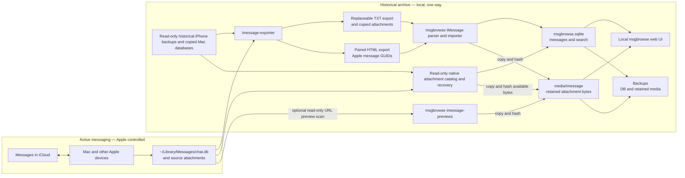

# Permanent offline iMessage archive: architecture

This is the architecture reference for this fork's iMessage archival behavior. The existing [upstream architecture](../ARCHITECTURE.md) describes msgbrowse as a whole. The Stage 1 assessment was based on commit `043562ae667e1fbc01b9c5609a49db8b12625eaf`; Stage 2 adds code and synthetic tests. Stage 3 validated limited real iMessage and SMS exports. A seven-snapshot, GUID-aware reconstruction validated message overlap and retained available media in an isolated archive; that reconstruction and later Drew-labeled historical backups are now in the configured local archive. Complete attachment recovery remains unverified.

## Purpose and scope

Apple Messages with Messages in iCloud remains the active messaging system. This fork aims to retain a searchable, local history after a user deletes selected older messages from Apple Messages to reduce iCloud storage. The archive must survive source deletion and remain usable offline. Repeated ingestion must add new content without removing earlier archived content.

This project reuses msgbrowse's Go application, SQLite store, web UI, and exporter integration. It does not sync data back to Apple Messages, replace active messaging, automatically delete archived messages, require a subscription, or introduce a new database or service. The Stage 2 code retains imported rows and media in synthetic tests; a limited real-data retention and restore drill also passed. Full-history completeness, broader exporter compatibility, and recovery from other failure modes still need validation. Do not delete anything from iCloud on the strength of this limited sample.

## System architecture

[`imessage-exporter`](https://github.com/ReagentX/imessage-exporter) is an
external, read-only exporter. It reads the local Apple Messages database
(`~/Library/Messages/chat.db`) and attachment files, then writes TXT transcripts
and copied attachments. It does **not** create msgbrowse's permanent SQLite
archive. Normal msgbrowse export/import consumes exporter files and does not
open Apple's database. The optional, explicit `imessage-previews` command reads
Apple's database and local preview files in read-only mode to backfill images
omitted by TXT export. msgbrowse identifies newly observed messages, preserves earlier imported
messages, copies attachment bytes into archive-controlled storage, and serves
SQLite-backed search and offline browsing. This flow never writes back to Apple
Messages or iCloud.



The boundary between `Export` and `Ingest` is deliberately one way. A later
export can omit a message deleted from Apple Messages. The importer treats
that omission as absent input for the current pass, not as an instruction to
delete the already archived row or attachment bytes.

Optional iMessage exclusion rules run after TXT parsing and before attachment
retention and `AppendIMessageMessages`. They may omit four- to six-digit sender
addresses (including exporter-added names in parentheses), `(smsfp)` and
`(smsft)` filtered-SMS conversations, incoming messages with the exact phrase
`appointment reminder`, entire named conversations with an owner-sent whole-message
`stop` or `quit` (case-insensitive), or explicitly named export conversations and phrases.
The opt-out rule skips the exporter's mixed `orphaned` bucket because it is not
a single thread. `imessage-import
--preview-exclusions` parses the export and reports aggregate rule counts
without opening the archive database or copying media. The policy is included
in incremental ingest state, so changing rules rescans unchanged TXT files.
Adding a policy rule alone cannot remove previously archived rows or bytes.
Owner-directed cleanup records deleted GUIDs and hashes in
`imessage_excluded_messages` (schema v28); the importer checks that ledger before
copying attachments or inserting messages. Export staging still contains omitted
messages until separately cleaned. Apple's “Unknown Senders” classification is
not present in the parsed TXT record. The cleanup below used read-only Apple
metadata for GUIDs currently present in that database; future unseen unknown
senders are not automatically classified by TXT import. No full-history
exclusion accuracy has yet been established.

**Current:** `msgbrowse export` invokes `imessage-exporter -f txt -c clone -o <imessage_archive_root>`; this normal path does not open `chat.db` ([`internal/cli/export.go`](../internal/cli/export.go), `exportIMessage`). The importer scans top-level `<ChatName>.txt` files, preserves legacy attachment references before source replacement, copies available media to permanent storage, and inserts newly observed messages without deleting old rows ([`internal/imessage/import.go`](../internal/imessage/import.go), `Run` and `importConversation`; [`internal/imessage/media.go`](../internal/imessage/media.go); [`internal/store/imessage_archive.go`](../internal/store/imessage_archive.go)). For overlapping historical snapshots, [`scripts/imessage-reconstruct`](../scripts/imessage-reconstruct) produces TXT and HTML from the same source snapshot. `imessage-import --guid-html-root` pairs Apple's GUID in the HTML with each TXT message using timestamp, sender, and within-group order. It rejects incomplete pairings and uses the GUID to attach later media to an existing row even when an exporter renames the conversation. `imessage-source-assets` then reads the same source database and, for iPhone backups, `Manifest.db` in query-only mode. It records every attachment GUID linked to an archived message, copies each available file into permanent media, and keeps hidden opaque payloads out of the ordinary gallery. The Providers flow still exports into staging and swaps the managed export root, but retains referenced media first ([`internal/onboard/runner.go`](../internal/onboard/runner.go), `execute`; [`internal/onboardsvc/onboardsvc.go`](../internal/onboardsvc/onboardsvc.go), `PreserveBeforeReplacement`).

**Target beyond the current reconstruction:** Determine which attachment bytes remain unavailable in every snapshot, validate more exporter versions and ambiguous same-second ordering, and establish a safe manual deletion procedure. Source deletions must never travel back into the historical archive.

Other msgbrowse sources (Signal, WhatsApp) share the store's replacement method. Scope iMessage retention changes explicitly so their existing behavior is not changed accidentally ([`internal/ingest/ingest.go`](../internal/ingest/ingest.go), line 242; [`internal/whatsapp/import.go`](../internal/whatsapp/import.go), line 170).

## Data model and storage

The CLI creates `<data_dir>/msgbrowse.sqlite`; `data_dir` defaults to `./data`. `openStore` creates the directory, and `store.Open` enables WAL, foreign keys, and migrations ([`internal/cli/common.go`](../internal/cli/common.go), lines 16–30; [`internal/config/config.go`](../internal/config/config.go), line 337; [`internal/store/store.go`](../internal/store/store.go), lines 23–67). The database is ordinary SQLite using the pure-Go `modernc.org/sqlite` driver ([`go.mod`](../go.mod), line 21). Schema version is 28: v25 adds unique nullable `messages.source_guid`; v26 retains native attachment bytes and provenance; v27 records attachment GUIDs even when all examined sources lack a file; v28 records owner-directed exclusions ([`internal/store/schema.go`](../internal/store/schema.go)).

| Entity | Current identity and relationship |
| --- | --- |
| Conversation | `conversations.id`; unique `(source, name)`. For iMessage, `name` initially comes from the export filename. A paired GUID import keeps a previously archived message in its first conversation when a later export renames the file; it avoids creating an empty conversation when every GUID is already present. The explicit metadata-only orphan reassignment can change that conversation reference when a later Apple database proves a unique GUID-to-chat link. New messages under changed filenames can still split threads, so general thread reconciliation remains open. ([`internal/imessage/import.go`](../internal/imessage/import.go); [`internal/store/imessage_archive.go`](../internal/store/imessage_archive.go); [`scripts/imessage_reassign_orphaned.py`](../scripts/imessage_reassign_orphaned.py).) |
| Message | `messages.id` is a SQLite row ID; globally unique `messages.hash` still hashes source, export conversation, normalized second-resolution timestamp, sender, body, and occurrence sequence. For paired iMessage imports, `messages.source_guid` is Apple's stable GUID and is uniquely indexed. A later export with the same GUID reuses the first row even if the filename, body, or timestamp changes; later media, links, and reactions append. A TXT-only import still uses the legacy content hash. ([`internal/signal/message.go`](../internal/signal/message.go); [`internal/imessage/guid.go`](../internal/imessage/guid.go); [`internal/store/imessage_archive.go`](../internal/store/imessage_archive.go); [`internal/store/schema.go`](../internal/store/schema.go).) |
| Attachment | `attachments.message_id` references a message with `ON DELETE CASCADE`; rows store kind, relative path, and original name, **not file bytes**. iMessage text attachment lines are recognized by a path/extension heuristic. ([`internal/store/schema.go`](../internal/store/schema.go), lines 92–99; [`internal/imessage/parser.go`](../internal/imessage/parser.go), lines 58–76 and 221–244.) |
| Native attachment catalog | `imessage_attachment_observations` records each source attachment GUID linked to an archived message, including missing files. `imessage_source_assets` records each retained byte variant by source attachment GUID and permanent path. Visible files also appear in `attachments`; hidden opaque payloads remain in the source-assets table and permanent media tree without gallery cards. ([`internal/imessage/source_assets.go`](../internal/imessage/source_assets.go); [`internal/store/imessage_archive.go`](../internal/store/imessage_archive.go); [`internal/store/schema.go`](../internal/store/schema.go).) |
| Link and reaction | Links cascade with messages. Reactions use message hash and `(message_hash, emoji, actor)` uniqueness; iMessage tapbacks are parsed as reaction data on a message, not standalone messages. ([`internal/store/store.go`](../internal/store/store.go), lines 332–400; [`internal/imessage/parser.go`](../internal/imessage/parser.go), lines 93–127 and 188–201.) |
| Search and metadata | FTS5 `messages_fts` is maintained by message insert/delete/update triggers. `ingest_state` tracks a conversation's export file mtime, size, content hash, and last count; `ingest_runs` holds run summaries. Embeddings are optional and keyed by message hash. ([`internal/store/schema.go`](../internal/store/schema.go), lines 120–159 and 222–244.) |

The browser's iMessage conversation title is display-only. For a numbered
one-to-one thread, it uses a linked contact name or the most recent non-owner
sender label when archived variants retain the same first and last name;
unrelated names leave the address visible. For a participant-list
group, it substitutes names only where a matching one-to-one handle establishes
the person; unresolved addresses remain visible. The sidebar filter matches
that displayed title, while the transcript header shows the original address
list once in its metadata. The original `conversations.name` remains the media
path and archive identity; sender labels and message records are not rewritten.
The default command-line build cannot read macOS Contacts, so it cannot name
threads for which the archive has no reliable person label.

The paths have distinct owners and lifetimes:

```text
~/Library/Messages/chat.db                 Apple-owned source database; never modified by msgbrowse
~/Library/Messages/Attachments/            Apple-owned source media
<backup>/Manifest.db and hashed files       read-only iPhone source snapshot
<workspace>/exports/<label>-txt/...         replaceable TXT and cloned media for one snapshot
<workspace>/exports/<label>-html/...        replaceable GUID-bearing HTML from that same snapshot
<export_dir>/<ChatName>.txt               manual, replaceable TXT export
<export_dir>/attachments/...              manual, replaceable copied attachments
<data_dir>/archives/imessage.staging/...  temporary Providers export while a job runs
<data_dir>/archives/imessage/...          adopted Providers export; still replaceable
<data_dir>/msgbrowse.sqlite               permanent message and search database
<data_dir>/media/imessage/<2-hex>/<sha256><ext>  permanent attachment and URL preview bytes
<data_dir>/derived/<path-hash>.jpg      regenerable HEIC/HEIF/TIFF browser previews
<data_dir>/backups/snapshot-.../...       default snapshot location; configurable
```

The Media page shows the configured permanent iMessage media folder and the
regenerable preview-cache folder, with the current sum of regular file bytes
in each. These are local folder sizes, not gallery item counts; other sources
may retain files in their separate export roots. The sidebar shows each
conversation's archived message count in its colored circle and the date of
its latest archived message at the right of the title row.

For manual CLI exports, `imessage_archive_root` points to `<export_dir>`.
Providers instead runs the exporter into staging and adopts the result under
`<data_dir>/archives/imessage` after success ([`internal/setup/layout.go`](../internal/setup/layout.go),
`ManagedRoot`; [`internal/onboard/runner.go`](../internal/onboard/runner.go),
`execute`). Neither export tree is permanent storage. The importer streams each
referenced regular attachment file into
`<data_dir>/media/imessage/<first-two-SHA256-hex>/<SHA256><lowercase-extension>`.
It creates files without overwriting an existing copy and verifies an existing
file's hash. SQLite stores `permanent/<first-two-hex>/<SHA256><extension>`;
[`internal/archivepath/archivepath.go`](../internal/archivepath/archivepath.go),
`Resolve`, maps that namespace to retained storage. Unchanged bytes and
extension share one file across messages. Export paths remain read-only input.
Missing new media fails that conversation's import; a previously retained,
verified attachment can survive a later missing source file. Existing
pre-Stage-2 attachment references are copied and redirected when their source
bytes are still available. If those bytes were already lost, their historical
contents cannot be reconstructed or verified.

The optional `imessage-previews` command scans `com.apple.messages.URLBalloonProvider`
messages with hidden `.pluginPayloadAttachment` files from Apple's database,
using a read-only SQLite connection. It requires a unique match to an existing
archived link by local timestamp second, direction, and URL host found in Apple
message text or payload data. Zero or multiple matches are skipped and reported.
Supported local PNG, JPEG, and ICO bytes are copied into the same permanent
media tree; SQLite attachment rows mark the card image, extra images, and icons
separately. The card image appears in the transcript, while extra assets are
retained outside the ordinary photo gallery. The full URL remains in the link
target and copy control, but URL-only text lines are hidden in the transcript.
This command does not fetch remote metadata or images and cannot recover files
already removed from the Mac. It does not import otherwise missing messages.
Run it before removing source data and include the retained media in backups.

The Backups feature uses `VACUUM INTO` for the SQLite DB and now copies retained iMessage media into each snapshot, listing checksums for every file in its manifest. Restore verifies checksums and restores missing media before swapping in the snapshot DB; it leaves newer retained files intact ([`internal/backup/manager.go`](../internal/backup/manager.go), `Create`, `Restore`, `copyRetainedMedia`, `restoreRetainedMedia`). Older snapshots made before Stage 2 may contain only the DB and config. Restore them only after separately verifying that all referenced media still exists.

Browsers cannot display original HEIC/HEIF/TIFF files. `imessage-import` now
runs the existing local image converter after importing, producing cached JPEG
derivatives under `<data_dir>/derived`; the gallery and transcript serve these
previews while retaining the original bytes under permanent media. The cache is
not part of a backup and can be rebuilt after restore with `msgbrowse media`.
If no converter is installed or a conversion fails, the UI shows a download
placeholder until conversion succeeds. The limited real sample had four HEIC
originals; running `msgbrowse media` produced four valid JPEG derivatives, and
the local media route returned JPEG with HTTP 200 for a representative image.

### Exporter dependency and completeness

The CLI locates `imessage-exporter` on `PATH` unless
`--imessage-exporter-bin` (for `msgbrowse export`) or
`imessage_exporter_bin` in config specifies a path. The CLI does not install
it. `msgbrowse export` invokes
`imessage-exporter -f txt -c clone -o <imessage_archive_root>`; the standalone
command can be run with those same flags. The `serve` Providers flow uses the
config path or `PATH`, and the desktop app uses its bundled binary. Providers
uses `-f txt -c clone -o <staging_dir>` and imports the adopted result. The
[upstream 4.2.0 binary documentation](https://github.com/ReagentX/imessage-exporter/blob/4.2.0/imessage-exporter/README.md)
defines `clone` as copying attachment files without conversion.

The parser targets the exporter **4.2.0 TXT layout**
([`internal/imessage/parser.go`](../internal/imessage/parser.go)); the desktop
build pins exporter **4.2.0**
([`.github/workflows/desktop.yml`](../.github/workflows/desktop.yml)). Tests
use synthetic text and media. A limited real export made with **5.0.1** also
parsed and imported, but this does not establish general 5.0.1 compatibility
or a supported version range. The CLI has no version pin or runtime version gate. Check a local
binary with `which imessage-exporter` and `imessage-exporter --version`, record
the result, and validate output after changing versions. There is no established
minimum version or verified compatibility range. Pinning a version for a
reproducible archival workflow is advisable **after** validating it on a
disposable real export; a Homebrew install may change with future upgrades.

An exporter failure prevents the Providers staging tree from being adopted;
in a manual workflow, stop on export failure rather than importing a possibly
partial output directory. Success of the exporter alone does not establish
completeness. Attachments absent from the local Mac, including files not fully
downloaded from iCloud, cannot be copied. [Exporter
diagnostics](https://github.com/ReagentX/imessage-exporter/blob/develop/docs/diagnostics.md)
report missing files; msgbrowse's parser can also skip an `Attachment missing!`
notice, while a missing file referenced by a parsed attachment fails that
conversation's import. Compare expected counts and representative media with
the source and resolve every error before relying on the archive.

## Data retention policy

| Source event | Required target behavior | Current behavior |
| --- | --- | --- |
| New message | Insert once | Source-scoped hash with `ON CONFLICT DO NOTHING`; newly observed attachment and reaction rows are appended. |
| Unchanged repeated import | Skip without duplication | Export file content hash skips unchanged text; `--full` reparses and insert is idempotent. |
| Message or conversation removed from source | Keep archived rows and media | Missing messages are never deleted; a missing conversation file is not scanned. |
| Attachment removed from source | Keep archived bytes and reference | Existing retained copy and SQLite reference remain. |
| Edited source message | Preserve previously archived content | Changed body has a new hash; both observed versions remain. The exporter may not expose every edit revision. |
| Reaction changed | Do not lose prior message content | Newly observed reactions append; older reaction observations remain. |

The iMessage importer calls `AppendIMessageMessages`, which preserves existing rows and their FTS entries and adds new rows in a transaction. Signal and WhatsApp continue calling `ReplaceConversationMessages`, whose delete/reinsert semantics are unchanged ([`internal/store/store.go`](../internal/store/store.go), `ReplaceConversationMessages`). A changed text export is hashed even if its mtime and byte size are unchanged. If attachment bytes change while the text export is identical, a normal import skips it; `imessage-import --full` re-examines attachments and can retain the newly observed bytes.

Providers no longer renders Disable for iMessage. A crafted Disable request is rejected with HTTP 409, and `DeleteSourceData` independently refuses iMessage; other sources retain their existing Disable behavior ([`internal/web/disable.go`](../internal/web/disable.go); [`internal/store/sources.go`](../internal/store/sources.go)). Source-driven deletion of archived messages or attachments is prohibited. Normal index, metadata, and backup maintenance may continue.

**Identity strategy and limits:** The existing hash of `(source, export conversation name, normalized second-resolution timestamp, sender, body, occurrence sequence)` is retained. The text records consumed here do not carry an Apple message GUID, although the exporter works from a database that has GUID fields ([exporter diagnostics](https://github.com/ReagentX/imessage-exporter/blob/develop/docs/diagnostics.md)). Reordering different messages preserves their hashes; byte-identical messages within a conversation get distinct sequence numbers. Deletion and later addition of otherwise identical messages can reuse an occurrence number and be mistaken for a prior message. A renamed group export file can create a second conversation. Attachment-only messages with the same sender/time can also be ambiguous because attachment paths are not in the hash. An edit creates a new hash and preserves the old content, but cannot be linked conclusively to its prior version. These are unresolved until a supported export format yields stable source IDs or real-history validation establishes a safer matching rule. Do not claim lossless identity for these cases.

## Operational lifecycle

This is a validation workflow for the implementation, not yet a safe instruction to reduce iCloud content:

1. Ensure the desired messages and full attachment originals are downloaded to the Mac; verify this outside msgbrowse as well as through exporter diagnostics.
2. Export from the local Messages database with `imessage-exporter` in copy mode. Full Disk Access may be required for the terminal or app running it.
3. Import into msgbrowse's SQLite store and independently retained media storage. Resolve every import error before relying on the result.
4. Verify expected conversations and counts, sample search results and open every required attachment class, and run integrity checks. The current `doctor` samples image attachment paths; it is not a complete archival verification ([`internal/cli/doctor.go`](../internal/cli/doctor.go), lines 377–421).
5. Create a new-format backup of **both** the SQLite database and retained attachment files, then verify restore on a separate copy. Older DB-only snapshots do not cover media.
6. **Only after verification and backup**, remove selected historical items from Apple Messages/iCloud, following a separately validated procedure. This action is irreversible across synced devices and is outside Stage 2.
7. Repeat export and import periodically to capture new content; recheck retention and backup integrity before any further source deletion.

Do not begin step 6 until real-history completeness, unresolved identity cases, attachment integrity, and recovery have been verified.

## Build and offline operation

The core CLI requires the Go toolchain specified in [`go.mod`](../go.mod) (`go 1.25.8`, `toolchain go1.27.0`); dependencies must be available locally or downloaded once for a build. `make build` builds `./bin/msgbrowse` with `CGO_ENABLED=0`, including on macOS arm64 ([`Makefile`](../Makefile), lines 39–46 and 64–73). `imessage-exporter` is required to create a fresh iMessage export, but not to browse an already populated store and present media tree. The desktop shell is a separate Wails/cgo module; the core CLI path avoids those dependencies ([`Makefile`](../Makefile), lines 47–58).

```sh
make build
brew install imessage-exporter   # only if you need to produce a fresh iMessage export
./bin/msgbrowse --data-dir ./data --imessage-archive-root /absolute/path/to/imessage-export imessage-import
./bin/msgbrowse --data-dir ./data --imessage-archive-root /absolute/path/to/imessage-export doctor
./bin/msgbrowse --data-dir ./data --imessage-archive-root /absolute/path/to/imessage-export serve
```

To generate an export with the existing CLI, set an iMessage root and run `./bin/msgbrowse --imessage-archive-root /absolute/path/to/imessage-export export`; it invokes copy mode. Use a disposable or separately backed-up export location for validation. Do not point it at irreplaceable historical media while the exporter's overwrite behavior remains unverified. Keyword search and browsing do not need an LLM or network. Optional AI features require a configured endpoint; the exporter is a separate subprocess, so its own behavior and permissions must be assessed. A completed local archive can operate offline only if its DB and every referenced media file are present.

## Design principles

- Reuse msgbrowse's parser, store, UI, and existing workflow; make the smallest targeted changes.
- Preserve upstream compatibility where practical and keep other sources' semantics explicit.
- Prefer SQLite and ordinary local files; avoid subscriptions, cloud dependencies, and unneeded services, databases, frameworks, or intermediary applications.
- Prioritize data preservation over ingestion convenience. Never let a source deletion remove archived content.
- Make repeated imports safe and idempotent, including after a partial failure.
- Treat source exports as replaceable input and the historical archive as independently retained output.

## Risks and limitations

| Risk | Evidence and required validation |
| --- | --- |
| Apple/macOS or exporter format change | Parser targets `imessage-exporter` 4.2.0 text layout ([`internal/imessage/parser.go`](../internal/imessage/parser.go), lines 1–28). Validate against real exports and each upgrade. |
| Missing local downloads | `clone` and the native source scan can preserve only files present on disk. The catalog retains attachment GUIDs without bytes so later backups can fill gaps; 1,631 linked GUIDs remain unavailable after the Seagate import. Parser missing-attachment notices still do not carry bytes. |
| Identity and edits | TXT alone lacks GUIDs and content hashes change with body or conversation name. Paired exporter 5.0.1 HTML supplies GUIDs. Same-second/sender groups are paired in exporter order, which matched precise source date order in the three tested snapshots; exact native date ties and other exporter versions remain a compatibility risk. The first imported body remains visible when later snapshots render a changed body for the same GUID; later text revisions are not yet stored separately. |
| Attachment integrity | Legacy references may already outlive their original bytes. The importer verifies retained bytes when copying; validate actual attachment classes and sizes on real history. The 11 omitted hidden rows in the Stage 3 sample were URL preview payloads; the optional backfill now retains their bytes in this sample. Do not treat `hide_attachment` alone as proof that a file can be excluded in other conversations. |
| URL preview matching | TXT exports lack source GUIDs and omit thumbnail files. The optional scan requires a unique timestamp, direction, and URL-host match. Timestamp ties, absent URL metadata, unsupported file types, or unavailable local files require manual review. No remote image fetching is performed. |
| SQLite corruption and recovery | WAL database needs a consistent backup. New snapshots include DB, config, and retained iMessage media; perform a restore drill on a separate copy. Older snapshots may lack media. |
| macOS and upstream maintenance | Full Disk Access, exporter availability, text format, and Go/Wails dependencies can change. Keep format fixtures and a tested offline build path; do not assume continued upstream updates. |

## Limited Stage 3 real-data validation (2026-11-06)

Approved, isolated exports covered 2026-10-20 through 2026-11-05 using
`imessage-exporter` 5.0.1. One participant filter matched after removing
phone punctuation. A second phone number was corrected by the user and then
matched; the originally supplied digits and the confirmed email had no exact
matching handle in the local Messages database. The corrected phone export
contained 15 messages, and a read-only query of Apple's chat metadata counted
five RCS and ten SMS messages for that handle in the selected window. The first
participant's selected chats contained 106 iMessage messages, 14 SMS messages,
and nine iMessage reaction rows. The exporter's 120 timestamped messages and
msgbrowse's 120 message rows plus nine reaction rows match those source
categories. Daily counts for the 120 source message rows and 120 exported
timestamp headers also match across the window. This provides limited real
iMessage-transport coverage, although TXT does not carry stable source GUIDs
for per-message identity matching. No personal message text or participant
identifiers were recorded in this report.

The exporter read Apple's database without modifying it. msgbrowse imported
disposable byte-for-byte copies into a separate archive. The first import
produced 120 messages, five conversations (four individual and one group with
six real messages), and ten retained attachments. The message count matched
the 120 timestamp headers in those transcripts; messages spanned 14 dates
within the selected window. The attachments comprised HEIC, MOV, PNG, GIF,
and VCF files. A read-only source audit found 21 attachment rows associated
with iMessage-service messages in the selected chats: ten visible and eleven
marked hidden by Apple. All 21 source files were present locally. The ten
visible source hashes matched the ten copied exporter files exactly. All
eleven hidden rows had the `.pluginPayloadAttachment` extension and belonged
to four `com.apple.messages.URLBalloonProvider` messages. They represented
eight distinct hashes and 644,528 bytes; none appeared in the export. Each
of the four source timestamps had a URL-bearing TXT block and no attachment
path. This timestamp match is evidence that the links were rendered, though
TXT lacks GUIDs for a definitive per-message match. Exporter 5.0.1 describes
`hide_attachment` as a [Messages UI flag](https://github.com/ReagentX/imessage-exporter/blob/5.0.1/imessage-database/src/tables/attachment.rs#L164-L170)
and [renders URL balloons](https://github.com/ReagentX/imessage-exporter/blob/5.0.1/imessage-exporter/src/exporters/txt/balloons.rs#L44-L53)
from URL data; the [TXT attachment renderer](https://github.com/ReagentX/imessage-exporter/blob/5.0.1/imessage-exporter/src/exporters/txt/mod.rs#L218-L268)
uses attachment ranges in the message body. For this sample, the omitted files are auxiliary link-preview
payloads, not missing user-visible attachments. The initial archive did not
retain these cache bytes; the optional preview backfill described below does.
A second clean archive imported those 120 messages and then added all 15
messages from the corrected phone export, yielding 135 distinct messages in
six conversations and the same ten attachments. There were no
exporter `Attachment missing!` notices in either sample, and all ten SQLite
references for exported attachments resolved to archive-owned files whose
SHA-256 hashes matched the copied source files. Repeated imports added zero messages.
Keyword search returned real-message hits, and the chronological query
returned nondecreasing timestamps.

A second, independent `imessage-exporter` 5.0.1 run used the same participant
filters and date window in a new isolated export directory. Its seven TXT
transcripts and ten copied files had the same relative paths and SHA-256
checksums as the first exports; the timestamp-header counts were again 120
and 15. A consistent SQLite copy of the clean 135-message archive was placed
in a disposable directory. Running `imessage-import --full` against both new
exports forced parsing and insertion checks rather than relying on the
unchanged-file shortcut. Both imports added zero messages. The copied archive
still had the same 135 message hashes, six conversations, nine reactions, and
ten media hashes, and passed `PRAGMA integrity_check`. This validates one
independent repeat export with the same exporter version and source window;
it does not prove identity stability after contact renames, edits, exporter
upgrades, or timezone changes.

In the disposable export only, one message with an attachment and one entire
conversation transcript were removed, along with the selected source media
file. Reimport added zero messages and retained all 120 prior message hashes,
all five conversations, and all ten archived media checksums. Adding one
synthetic message to that disposable export added exactly one archive row and
one searchable result; repeating the import added zero duplicates. This tests
source omission, not deletion from Apple Messages or iCloud.

`msgbrowse backups create` made a snapshot containing the SQLite database,
manifest, configuration, and ten retained media files. A byte-identical copy
of the snapshot was restored over a disposable database in a separate
directory. The restored database passed `PRAGMA integrity_check`, contained
121 messages, five conversations, and ten valid attachment references, and
returned the synthetic search result. With the exporter absent from `PATH`,
the restored loopback browser served its home and search pages and returned
all ten media files with the expected checksums across all five file types.
`msgbrowse doctor` exited successfully with no problem checks; its warnings
reflected unconfigured optional archive roots and exporters in the isolated
restore setup.

A second snapshot of the clean 135-message combined archive was copied and
restored into another separate directory. The restored database passed
`PRAGMA integrity_check`, retained the same 135 message hashes and ten media
checksums as the source archive, and had six conversations and ten valid media
references. Without the exporter on `PATH`, its local browser returned the
home page, a real-message search result, and a media file with the expected
checksum.

After identifying the hidden files, a scoped, read-only preview scan matched
all four URL balloon messages to one archived link each by local second,
direction, and URL host. One source message had no plain-text URL, so its host
was found in Apple's payload data. The scan retained eleven image references
(six PNG, four JPEG, one ICO) representing eight distinct SHA-256 files and
644,528 bytes. A repeat scan with the rebuilt command matched the same four
messages and eleven assets, reported no missing or ambiguous matches, and
added zero references. A new snapshot was restored into a separate disposable
directory; source and restored databases both passed SQLite integrity checks,
held 135 iMessage rows and six conversations, and had eleven preview references
resolving to eight hash-verified files. This sample does not
prove unique matching across full history or coverage for other balloon types.

These samples do **not** establish full-history completeness, behavior for
unavailable iCloud downloads, stability under renamed contacts or duplicate
source messages, or safety of deleting Apple/iCloud data. Other hidden
attachment types may need retention; classify them by type and context rather
than by `hide_attachment` alone. The TXT export lacks Apple message GUIDs.
Compare complete
source/export/archive counts and all required media across the full history
before relying on the archive for storage reduction.

## Three-snapshot reconstruction validation (2026-11-06)

An isolated archive under `/Users/drew_wilkins/Documents/Messages/reconstruction/2026-11-06-backups/archive-guid` was built from two read-only iPhone backups (July 2024 and October 2025) and a consistent, read-only copy of this Mac's November 2026 `chat.db`. Each source was exported separately with `imessage-exporter` 5.0.1 into TXT with cloned attachments and HTML without copied media. The active Apple database, iCloud, and `/Users/drew_wilkins/Documents/Messages/data` were not changed. Source order was oldest to newest for this run; GUID identity makes the union independent of that order, while the first observed text and conversation label remain the displayed versions.

| Source | Distinct HTML GUIDs | Newly seen GUIDs at this step |
| --- | ---: | ---: |
| July 2024 iPhone backup | 18,311 | 18,311 |
| October 2025 iPhone backup | 39,051 | 21,131 |
| November 2026 Mac snapshot | 49,986 | 12,356 |
| **Union** | | **51,798** |

The configured exclusion policy accounts for all 270 GUIDs absent from this three-source archive: each has a five- or six-digit sender or conversation identifier that satisfies the short-code rule. At this step, the archive contained **51,528 messages with 51,528 unique non-null GUIDs**. Before direct native attachment recovery, TXT import had 2,922 attachment references and 2,773 distinct retained media files; all 5,633,386,794 referenced bytes hash-checked. Reimporting the current snapshot added zero messages and zero media conversions; after removing 144 empty conversation shells created by the earlier implementation, the corrected importer created none on the repeat pass. No personal message bodies were used in the report.

The three native databases contain 55,107 distinct raw message GUIDs, 3,309 more than the HTML export union. Classifying those 3,309 by their latest native row found 2,808 associated-message events, 470 system or group events, and 31 rows with summary metadata but no ordinary text or attachment join. No raw row classified as ordinary chat text or joined media was absent from the exporter union. This is a structural count check, not proof that every event or summary is rendered faithfully in TXT or the browser.

A msgbrowse backup of that initial archive was restored into a different directory. Source and restored databases each passed `PRAGMA integrity_check`, contained the same 51,528 GUIDs and 2,773 media files, and returned the same 12,582 matches for a generic local FTS query. All restored media paths existed and all 5,633,386,794 bytes passed their SHA-256 name checks. With `imessage-exporter` absent from `PATH`, the restored browser served its home page and a retained media file over loopback with HTTP 200; the served media hash matched the archive file. The restore did not touch the production archive.

The native attachment pass found **9,082 distinct attachment GUIDs** linked to archived messages. All **6,363** whose bytes were available in at least one of these three sources now have archive-controlled retained files and provenance records. This includes 112 visible attachment references omitted by TXT; hidden plugin payload bytes were retained separately without gallery cards. The catalog records **2,719 attachment GUIDs still without bytes** across these sources, including 1,625 marked visible (1,474 images, 68 videos, and other files) and 1,094 hidden-only assets. After recovery, the archive has 3,034 visible attachment references, 2,885 distinct displayed paths, and 4,603 distinct files across displayed and raw assets. All 6,111,537,726 bytes in those 4,603 files passed their SHA-256 name checks. This gap is durable in SQLite and can shrink as later backups are ingested; existing retained bytes do not depend on those source drives.

A second msgbrowse backup after native recovery was restored into the separate test directory. Source and restored databases both passed SQLite integrity checks and matched on 51,528 message GUIDs, 9,082 cataloged attachment GUIDs, 6,363 GUIDs with bytes, 12,582 generic FTS hits, and all 4,603 retained file hashes and byte counts. With the exporter absent from `PATH`, the restored loopback browser served its home page and one newly recovered visible attachment with HTTP 200 and the expected SHA-256. The production archive was not used.

At this three-source step, attachment recovery remained **unverified**: source diagnostics reported 1,119 missing files in 2024, 4,762 in 2025, and 4,919 on the current Mac, and 2,719 distinct linked identifiers remained unavailable. The first observed body is retained when the same message GUID has different text in another snapshot; alternate bodies are not yet stored as revisions. Same-second/sender pairing was checked against native date order in all three databases (226, 462, and 565 ambiguous groups respectively, with no order inversions). In 79 groups with distinct source text that could also be matched exactly to the TXT body (175 messages), the order had no mismatches. Groups with exactly equal native timestamps remain an unresolved identity ambiguity. Hidden plugin payloads are saved raw but not decoded into UI thumbnails. Do not infer that Apple/iCloud deletion is safe from these counts alone.

## Fourth-snapshot recovery (2026-11-06 local time)

An October 2026 iPhone backup on a mounted network share was distinct from the October 2025 backup despite sharing the device ID. The exporter could not open SQLite directly on the share, so the files needed for Messages were copied to `/Volumes/KINGSTON/msgbrowse-sources/iphone-2026-10-19-network`: the manifest, metadata plists, `sms.db`, contacts databases, and the Messages attachment files present in the manifest. Of 12,546 listed files, 3,542 were present on the share and copied; the absent files were not manufactured. The network source was not changed. TXT and HTML were generated from that same local copy with exporter 5.0.1, then imported into the existing isolated archive.

The fourth HTML export contained 50,090 distinct message GUIDs, of which 130 were new to the prior three-source union. It added 105 archived messages; the other 25 new GUIDs matched the configured five/six-digit short-code exclusion. The **four-source union is 51,928 GUIDs**, with **51,633 unique archived GUIDs** and 295 excluded. All 273 excluded GUIDs present in this fourth source had five/six-digit native sender handles; the other 22 exclusions were verified in the earlier source analysis. Repeating the fourth import added zero messages, zero native assets, and zero visible references.

The native attachment catalog now contains **9,690 distinct GUIDs** linked to archived messages. **7,368** have retained bytes from at least one source, 1,005 more than after the first three sources; **2,322** still have no bytes in any of these four sources, including **1,293 visible** attachments. The fourth source added 1,566 source-asset rows and 22 visible references, while its TXT export added other visible references. The archive has 3,295 visible attachment references, 3,134 distinct displayed paths, and 5,145 distinct files across displayed and raw assets. All **6,550,743,932 bytes** in those files passed SHA-256 checks; SQLite integrity returned `ok` and a generic FTS query returned 12,612 matches.

Snapshot `snapshot-20261107-033556` was restored into the separate `restore-test` directory. The restored database matched the source on 51,633 message GUIDs, 9,690 cataloged attachment GUIDs, 7,368 available GUIDs, 3,295 visible references, and 12,612 generic FTS hits. All 5,145 restored files existed and passed the same SHA-256 and byte-count checks. With the exporter absent from `PATH`, the restored loopback browser served the home, media gallery, conversation, and a retained image with HTTP 200; the image response hash matched its archive file. Neither the active Apple database nor the production archive was used.

At this four-source stage, the remaining 2,322 attachment GUIDs required more source snapshots or a separate recovery method. Same-second GUID pairing and alternate body revisions retain the limitations described above. These results do not establish that Apple/iCloud deletion is safe.

## WD Elements Time Machine recovery (2026-11-06 local time)

The mounted `2017 MBPro13` volume contained completed Time Machine snapshots dated July 2020 and April 2022. Each had a readable `chat.db`, WAL files, and an Attachments directory; the source and isolated database copies passed SQLite integrity checks. A separate November 2026 `.inProgress` snapshot was not used. The completed source files were read only. The immutable database copies live under the isolated workspace's `source-db/wd-mac-*` directories, and exporter TXT/HTML staging remains separate for each snapshot.

The April 2022 HTML export had 21,063 distinct message GUIDs, including 4,832 new to the four-source union. It added 4,598 messages and raised available attachment GUIDs from 7,368 to 8,849. The July 2020 HTML export had 5,167 distinct GUIDs, including 60 further new GUIDs; it added 14 messages and made four more attachment GUIDs available. All 280 newly excluded GUIDs had five- or six-digit native sender handles. Across **six sources**, the HTML GUID union is **56,820**: **56,245 unique messages** are archived and 575 meet the configured exclusion rule. Repeating each WD import added zero messages, native assets, or visible attachment references.

The April 2022 export exposed a parser error: a scheme-less web path ending in `.html` was classified as an attachment. Clone-mode attachment detection now requires the exporter's `attachments/` prefix, with a regression test for a scheme-less web path. The first import had already appended other conversations; the corrected rerun added the one affected message without duplicating the rest. No source database was modified.

The attachment catalog now contains **10,478 distinct GUIDs** linked to archived messages. **8,853** have retained bytes; **1,625** remain unavailable across all six sources, including **840 visible** assets. The archive has 4,271 visible attachment references, 4,057 distinct displayed paths, and 6,310 distinct files across displayed and raw assets. SQLite integrity returned `ok`; all **8,835,378,223 bytes** in those files passed SHA-256 checks; a generic FTS query returned 13,849 matches.

Snapshot `snapshot-20261107-035406` was restored into the separate `restore-test` directory. The restored database matched the source on 56,245 message GUIDs, 10,478 cataloged attachment GUIDs, 8,853 available GUIDs, 4,271 visible references, and 13,849 generic FTS hits. All 6,310 restored files existed and passed hash and byte-count checks. With the exporter absent from `PATH`, the restored loopback browser served its home, media gallery, conversation, and a retained image with HTTP 200; the image response hash matched its archive file. The production archive and Apple/iCloud data were not used. The remaining 1,625 unavailable GUIDs and the identity limitations above still prevent a claim of full archival completeness.

## Embedded iPhone backup on WD Elements (2026-11-06 local time)

The completed April 2022 Time Machine snapshot also contained an unencrypted iPhone MobileSync backup dated April 3, 2022. Its manifest and Messages database passed SQLite integrity checks. The manifest listed 5,638 files needed for this workflow; 2,683 were present and copied to the isolated `source-ios/wd-iphone-2022-04-03` directory, including the manifest, Messages and contacts databases, and available SMS attachments. The unavailable source files were not fabricated. The completed Time Machine source was read only; the separate November 2026 `.inProgress` snapshot was not used.

The iPhone HTML export had 17,401 distinct message GUIDs, 65 new to the six-source union. It added 42 archived messages; all 23 newly excluded GUIDs had five- or six-digit native sender handles. The **seven-source union is 56,885 GUIDs**, of which **56,287 are uniquely archived** and 598 meet the configured exclusion rule. Repeating the iPhone import added zero messages or native assets.

The iPhone source supplied 2,505 native attachment records linked to archived messages. Its attachment GUIDs are not necessarily the same as the Mac attachment GUIDs for overlapping messages, so both the available and total catalog counts grew. Across seven sources, **11,351 of 12,982** cataloged attachment GUIDs have retained bytes and **1,631** do not, including **843 visible** assets. The archive has 4,659 visible attachment references, 4,393 distinct displayed paths, and 6,649 distinct files across displayed and raw assets. SQLite integrity returned `ok`; all **9,716,787,667 bytes** in those files passed SHA-256 checks; a generic FTS query returned 13,855 matches.

Snapshot `snapshot-20261107-040204` was restored into the separate `restore-test` directory. The restored database matched the source on 56,287 message GUIDs, 12,982 cataloged attachment GUIDs, 11,351 available GUIDs, 4,659 visible references, and 13,855 generic FTS hits. All 6,649 restored files existed and passed hash and byte-count checks. With the exporter absent from `PATH`, the restored loopback browser served its home, media gallery, conversation, and a retained image with HTTP 200 and the expected SHA-256. The production archive and Apple/iCloud data were not used. Missing attachment bytes and the identity limitations above still prevent a claim of full archival completeness.

## Local archive activation (2026-11-06 local time)

The previous configured database at `/Users/drew_wilkins/Documents/Messages/data` held 135 messages, all of whose message hashes were present in the seven-source reconstruction. Its six links, nine reactions, and five contact identities matched there. All 21 visible attachment references had matching bytes in the reconstruction; eleven URL preview references initially existed only as raw hidden assets. An explicit, read-only scan of a copied November 2026 Apple database added 23 URL preview assets to the reconstruction, after which all 21 former visible references matched. The scan also reported one ambiguous URL balloon and one missing source file; neither was silently treated as retained. The former database and its backup remain available for rollback.

A consistent post-preview snapshot, `snapshot-20261107-042346`, supplied the SQLite database and retained media for `/Users/drew_wilkins/Documents/Messages/archive`. Every referenced file in that new path passed SHA-256 checks: 6,667 distinct files and 9,719,379,922 bytes. SQLite integrity returned `ok`; the archive retained 56,287 unique GUID messages, 12,982 cataloged attachment GUIDs, and 11,351 GUIDs with bytes. The local config now points `data_dir` at this archive and `backups.dir` at `/Users/drew_wilkins/Documents/Messages/archive-backups`. The first configured archive backup, `snapshot-20261107-042645`, was restored into `/Users/drew_wilkins/Documents/Messages/archive-restore-check`: SQLite integrity, message and attachment counts, 13,855 generic search hits, and all 6,667 file hashes and byte counts matched the configured archive. `msgbrowse doctor` found no problems, and the configured browser served its home, media page, and a hash-checked image over loopback. The old `/Users/drew_wilkins/Documents/Messages/data` directory was not replaced or deleted.

Future historical sources with `Manifest.db` should use [`scripts/imessage-reconstruct`](../scripts/imessage-reconstruct) with the existing staging workspace and `/Users/drew_wilkins/Documents/Messages/archive` as `DATA_DIR`. Older `Manifest.mbdb` backups require separate handling described below. Ordinary Providers refresh still emits TXT alone and does not provide the GUID pairing used for overlapping backups. The archive is operational locally; the 1,631 missing attachment identifiers, ambiguous same-second pairing, and unretained alternate message bodies remain limitations. Apple Messages and iCloud remain untouched.

## Seagate historical import (2026-11-07 local time)

The read-only `/Volumes/Black Seagate 1TB` Time Machine tree contained 22 distinct iPhone backup records. Eleven were explicitly labeled for Drew under the `drew_wilkins` Mac profile; seven were labeled for Gail, Eva, or Gabernat, and four initially had uncertain ownership. Nine Drew-labeled backups stored `sms.db` under its bare SHA-1 name; two older ones used the `.mddata` format, found in a later metadata review. A repeated April 2014 backup had the same 1,887 message GUIDs as its companion and was not imported twice. The active Apple Messages database and iCloud were not changed.

These are pre-iOS-13 backups with flat hashed files and `Manifest.mbdb`. `imessage-exporter` 5.0.1 rejects that backup-root layout, consistent with the [maintainer's stated support boundary](https://github.com/ReagentX/imessage-exporter/discussions/590). It could read the December 2013 and April 2014 `sms.db` files directly with `--platform macOS --db-path`. A private, normalized copy of each database mapped attachment filenames through its own `Manifest.mbdb` to copied files; no source backup was edited. Paired TXT/HTML exports from those copies added 5,842 and 1,878 messages, respectively. All 315 and 62 source attachment GUIDs mapped to available bytes. The configured archive retains those 377 attachment IDs at 335 distinct content-addressed paths; every such path exists and its filename SHA-256 matches its bytes. Repeating both imports added zero messages.

Six earlier Drew-labeled databases used legacy `msg_group`/`madrid` tables rather than the modern `chat` schema. A private bridge export selected text records with a clear address or handle and direction; it omitted rows with an explicit legacy room name. For iMessages, 272 previously unseen Apple `madrid_guid` values were paired with generated GUID-bearing HTML; the old direction bit was checked against 1,770 matching messages already in the archive. For SMS, the bridge used only flags 2/3 with an address and text, converted mixed Unix and Apple epoch dates to local time, rejected exact timestamp/body/direction matches already archived, and deduplicated overlaps among the six backups. The source SMS direction matched all 707 exact archive comparisons examined. The bridge staged 2,158 SMS records; 2,134 were new after msgbrowse's own hash check. It omitted 35 short-code records before import. The isolated bridge archive passed SQLite integrity and repeated imports added zero; production repeats also added zero. These were one-off private staging conversions, not a general legacy-backup command in the repository.

The older `madrid_attachment` table contained 106 records in the March 2013 backup. Opaque message attachment blobs gave a unique message-GUID association for 105, all with available files; one association was ambiguous and omitted. A dry run found all 105 linked to archived messages, and the actual source-assets pass added zero because these attachment GUIDs and bytes were already retained. Legacy MMS `msg_pieces` media remain unimported. A later read-only check found 147 of 149 March 2013 media parts map uniquely to available `Manifest.mbdb` files by `message_id` and `part_id`; one unmatched part has inline bytes and one file mapping is ambiguous. Linking parts to archived parent messages and retaining them has not been implemented or validated. Blank or undated legacy rows, unclear direction or address rows, legacy group records without a reliable one-to-one handle, and any attachment-only rows not represented by TXT remain outside this import. The bridge also cannot reconstruct Apple Messages' historical Unknown Senders classification. Do not treat this as a complete reconstruction of every old backup row.

The later owner review resolved two of the four uncertain labels without opening their message contents. A June 2009 backup named “Apple’s iPhone” has the same device identifier and serial as later “Drew’s iPhone” backups, but its `.mddata` SMS database contains zero messages. “Carol’s iPad” is excluded as a different owner. Both backups named “Siemens” are iOS 4 iPads with zero messages; their ownership remains unproven and they were not imported. The two already Drew-labeled `.mddata` backups contain 455 (June 2009) and 1,481 (April 2010) messages. Their SQLite databases passed integrity checks. After overlap and short-code filtering, 8 and 35 text records were staged, respectively; isolated repeats added zero duplicates, and production imports added **zero** new messages because msgbrowse recognized all staged records as already archived. The April 2010 backup also has 88 `msg_pieces` rows, including 36 media parts, which remain outside the archive pending a legacy MMS importer.

The configured archive now has **66,413 iMessage records**, up from 56,287, with no duplicate `source_guid` groups and SQLite integrity `ok`. Of **13,359** cataloged attachment GUIDs, **11,728** have bytes and **1,631** remain unavailable, including **843 visible** assets. `msgbrowse doctor` reported zero problems and five warnings for optional, unconfigured sources and semantic embeddings. The pre-import backup is `snapshot-20261107-051619`; the post-import backup is `snapshot-20261107-052840` under `/Users/drew_wilkins/Documents/Messages/archive-backups`. The latter backup's SQLite database passed integrity and contains 66,413 messages, but the snapshot has not yet been restored as a separate Seagate-specific drill. Private exports, normalized copies, and logs are under `/Users/drew_wilkins/Documents/Messages/reconstruction/2026-11-07-seagate`.

## Owner-directed exclusion cleanup (2026-11-07)

The user clarified that five- and six-digit short-code senders, appointment
reminders, Apple “Unknown Senders,” and exporter-labeled `(smsft)` and `(smsfp)`
conversations should not be in the configured archive. The prior short-code
rule missed exporter-added parenthetical names; neither filtered-SMS suffix was
recognized. The configured import now excludes both suffix families, including
their outgoing replies, and incoming text containing the exact phrase
`appointment reminder`. It does not infer “Unknown Senders” from the contact
list.

A read-only join of the current Mac's `chat.db` to archived Apple GUIDs found
373 archived messages attached to chats with `is_filtered=1`. Independent
open-source readers identify that exact value as Apple's Unknown Senders bucket
([Blip](https://github.com/nixfred/blip),
[Herald](https://github.com/ack-ventures/herald/blob/main/SPEC.md)); Apple does
not publish a stable contract for this private database field. The cleanup
targeted only those matched GUIDs, not other nonzero filter categories or
historical messages absent from the current Mac database.

After a full pre-cleanup snapshot, a single transaction recorded each selected
GUID and hash in the v28 exclusion ledger and removed **615 distinct messages**
from the configured archive: 102 short-code matches, 206 `(smsft)`/`(smsfp)`
matches, two exact-phrase appointment reminders, and 373 `is_filtered=1`
matches, with overlap among categories. All selected rows had Apple GUIDs.
Foreign keys and SQLite integrity passed. Of 69 permanent media paths attached
only to those messages, 69 files were removed after the database transaction;
none was shared with retained messages. Eight derived JPEG previews for those
paths were also removed from the local cache. The resulting archive contains
**65,798 iMessage messages**. Search's FTS row count matches that total;
`msgbrowse doctor` reports zero problems and the same five optional warnings.
The pre-cleanup snapshot is `snapshot-20261107-125525` under
`/Users/drew_wilkins/Documents/Messages/archive-backups`. Another 152 Apple
Unknown Senders GUIDs were present in the current Mac database but had not yet
been imported; these were added to the ledger without copying their content.
The final post-cleanup snapshot is `snapshot-20261107-130435`; its SQLite copy
passes integrity and contains 65,798 messages plus all 767 exclusion-ledger
entries. Its full media restore has not been drilled separately.

The ledger prevents already identified messages from being recreated when a
GUID-aware historical import is repeated. For TXT-only imports, it also checks
the stored hash, but TXT cannot distinguish every same-second identical message;
two removed rows used a GUID-specific collision hash. Use paired GUID-aware
exports for historical reimports. Future messages in Apple’s Unknown Senders bucket
cannot be identified from exporter TXT alone. Historical backups may not retain
that classification; their unclassified records need separate review. Existing
pre-cleanup backups still contain the removed messages and media, so restoring
one would require repeating this owner-directed cleanup.

## Transactional and opt-out cleanup (2026-11-07)

Five exact transactional conversations (Verizon, Lowe's, United Airlines, and
the numeric AT&T sender) and 18 one-to-one threads with an owner-sent whole-message
`stop` or `quit` were identified in the configured archive. A full snapshot,
`snapshot-20261107-133827`, was verified before cleanup. A transaction recorded
the Apple GUID and hash of each of the 69 selected messages in the exclusion
ledger, then removed the 23 conversations and their messages. Nine permanent
media files referenced only by those messages were removed after the transaction.
No selected message lacked an Apple GUID.

The local config now enables `imessage_exclude_opt_out_threads` and has exact
conversation rules for all 23 identified threads plus five verified sender
aliases. The dynamic rule excludes all messages in an export conversation when
one owner message is exactly `stop` or `quit`, ignoring case and surrounding
whitespace. The exact rules cover known threads when a later export omits that
reply. Exporter renames or new sender aliases can still require a new exact rule;
the GUID ledger protects the already removed messages. Nine owner opt-out
messages occur in the shared `orphaned` bucket of 14,737 unrelated records;
no thread-wide exclusion was applied there because the archive lacks a reliable
thread identity for those rows. That bucket also has messages mentioning these
brands; a body mention alone is insufficient to classify an unrelated archived
message as transactional.

The configured archive now has **65,729 iMessage messages** and **836** exclusion
ledger entries. SQLite integrity and foreign keys pass, and FTS has the same
65,729 rows. `msgbrowse doctor` reports zero problems and five optional warnings.
The intermediate snapshot `snapshot-20261107-134510` has SQLite integrity `ok`
and the same message and ledger counts at that point. A subsequent metadata
review found 14 more numeric sender threads with explicit Verizon, Lowe's, or
AT&T branding in archived messages. Their 52 messages were removed in another
ledger-first transaction: 41 had Apple GUIDs and 11 had only content hashes.
All 14 numeric addresses now have exact rules in the local config. They had no
attachment rows. At that cleanup stage, the archive had **65,677 messages**, **888 ledger
entries**, SQLite integrity `ok`, and an FTS row count of 65,677. The final
snapshot is `snapshot-20261107-135038`; its SQLite copy was checked for
integrity and matching counts. Earlier snapshots still retain excluded content
and need the owner-directed cleanup repeated if restored.

## Orphaned chat reassignment (2026-11-07)

`imessage-exporter` puts a message in `orphaned.txt` when its source database
has no `chat_message_join` entry for that message. The sender may still resolve
to a contact name; a name alone does not identify a chat, especially for group
and outgoing messages. The append-only GUID importer keeps the first archived
conversation reference when another snapshot later supplies a chat link.

The current Mac's `chat.db` was read with SQLite `mode=ro` and `query_only`.
A metadata-only audit matched **5,913** of the configured archive's 14,737
orphaned GUIDs to exactly one current Apple chat each. There were 120 affected
source chats. For 5,191 messages, other archived GUIDs in the same Apple chat
identified one existing archive conversation. For 129, Apple's exact unique
`chat_identifier` identified an existing conversation. The remaining 593
belonged to 56 Apple chats with no unambiguous existing archive destination;
the recovery created separate conversations named with those source chat
identifiers. It did not choose a destination from sender or contact names.

Before the move, `snapshot-20261107-141935` captured the database, config, and
permanent media. All 6,926 manifest file checksums were verified; the snapshot
database passed SQLite integrity and foreign-key checks and held 65,677
messages, including 14,737 orphaned. The checked transaction changed only
conversation references for the 5,913 selected message rows and their
attachment, link, and reaction rows. The post-move comparison with that backup
found identical message IDs, hashes, Apple GUIDs, attachment IDs and paths,
link IDs and URLs, and reaction IDs and hashes. Message, attachment, link, and
reaction row counts were unchanged; all 6,924 live permanent media files still
matched the pre-move backup checksums. FTS still had 65,677 entries. SQLite
integrity, foreign keys, child conversation references, and browser access
passed. `orphaned` now has **8,824** messages. No message or media bytes were
deleted, and Apple's database was not modified.

The repeatable [`scripts/imessage_reassign_orphaned.py`](../scripts/imessage_reassign_orphaned.py)
defaults to a dry run and requires the reviewed move count for `--apply`.
Future source snapshots can supply more GUID-to-chat links; rerun the audit
against each read-only source after a consistent SQLite checkpoint. This does not infer
thread membership for the 8,824 remaining records. Many still have a sender
label, and none should be classified as spam or deleted solely because they
remain orphaned. Normal TXT-only imports do not carry Apple GUIDs and can still
have overlap ambiguity after conversation reassignment; use paired GUID imports
for historical snapshots and review their result.

### Multi-snapshot orphan review and four-digit short codes (2026-11-07)

A later review found that the four-digit sender `7535` had passed the earlier
five/six-digit rule. The current ingest rule now covers four through six digits,
including exporter-added parenthetical names. A verified full backup,
`snapshot-20261107-144100`, contains the pre-review database, config, and all
retained media; all 6,926 manifest checksums, SQLite integrity, and foreign
keys passed. Ten previously archived four-digit sender messages were recorded
in the exclusion ledger before removal: six with Apple GUIDs in `orphaned` and
four legacy rows with content hashes in a named short-code conversation. They
had no attachment rows. Four associated link rows were removed with their
messages. The ledger prevents those same identities from returning on import.

The reassignment audit now accepts multiple read-only source databases and
unions their GUID-to-chat evidence. It skips any GUID whose destination or
group status conflicts between snapshots. The July 2024 iPhone, July 2020 Mac,
and April 2022 Mac snapshots supplied 2,283 consistent destinations; all were
moved in one checked transaction. Ninety-four conflicting GUIDs and 6,447
without a verified chat link were left untouched at audit time. The current
November 2026 Mac and October 2025 iPhone snapshots offered no further moves.
The November 2022 Gail Wilkins and Muff Harner examples have no chat link in
the available source snapshots that contain them, so their known sender names
do not justify assigning them to a conversation.

The archive now has **65,667 iMessage messages**, **898 exclusion-ledger
entries**, and **6,535 messages in `orphaned`**. Comparison with the verified
backup found exactly ten removed message IDs and 2,283 changed conversation
references; all other message IDs, hashes, and GUIDs remained stable. No
attachment or reaction identities changed. FTS has 65,667 rows, SQLite
integrity and foreign keys pass, and no four-digit numeric sender remains in
the archive. Among the remaining orphaned messages, 3,368 have a non-owner
sender label containing letters. Such a label identifies a sender, but does
not prove the message's original chat, especially for groups and outgoing
messages. Future source snapshots may provide additional verified links.

### Shared chat identifiers and remaining orphaned messages (2026-11-07)

A later audit included the copied April 2022 iPhone database alongside the five
previously checked sources. It first found **170** messages with one consistent
GUID-linked destination and moved them to six existing conversations. The
reassignment tool then exposed a missed case: Apple can repeat a
`chat_identifier` across distinct chat rows, but other already archived GUIDs
in the *same source chat row* can still identify exactly one archive
conversation. The tool now accepts that stronger evidence before requiring a
unique identifier. It also checks every source's chat links for contradictory
named destinations, even when that source's own move plan was skipped. Fifteen
additional candidates failed that cross-source check.

The revised six-source audit found **4,290** further moves into 11 existing
conversations. A repeat audit then found six more moves enabled by the newly
assigned same-chat evidence; the next pass found zero. At the fixed point,
**109** conflicting source destinations and **1,960** without verified chat
evidence remained. Small, consistent SQLite-only checkpoints were made before
the first and second transactions; the third six-message move used the second
checkpoint. No new full media snapshot was made because these moves did not
change media bytes. The transactions changed only conversation references for
4,296 message rows and their child attachment, link, and reaction references.
Before/after comparison found identical message IDs, hashes, GUIDs, text,
attachment paths, link URLs, and reaction identities. All six table counts
matched; SQLite integrity, foreign keys, and child conversation references
passed. Synthetic regression tests cover shared identifiers and a
contradiction hidden by a skipped source plan.

The configured archive still has **65,667 messages**, with **2,069 in
`orphaned`**. Of those, 946 are labeled “Me,” 1,005 have a non-owner name
containing letters, and 118 have numeric or other sender labels. Most remaining
records (1,850) date to 2022. Among the named examples reviewed, 307 Gail
Wilkins, 120 Muff Harner, two labeled Ji Son (identified by the owner as
Ji Hyun Son), five Harvey Kipnis, four David Huang, and 34 Chris DrumPriest
Theberge messages remain. The available snapshots do not supply a
nonconflicting chat assignment for them; the November 2022
examples have no verified chat link. Contact familiarity and chronological
adjacency do not establish group membership or the destination of outgoing
messages. A later source snapshot with intact chat joins, especially after
April 2022, may resolve more. Do not treat this residual bucket as spam or
delete it solely because its source chat is unknown.

## Implementation status

“Tested (synthetic)” means regression tests use fabricated exports and media.
“Tested (limited real sample)” refers only to the isolated participant-filtered
exports and restore drill described above. Apple's metadata confirms iMessage
transport for part of the first sample.

| Capability | Current behavior | Target behavior | Status |
| --- | --- | --- | --- |
| Local SQLite and keyword search | Store, FTS5 triggers, web UI exist | Reuse | Implemented |
| iMessage text export/import | CLI invokes copy-mode exporter; parser imports flat text | Reuse with format validation | Implemented |
| Unchanged-export skip | Content hash; `--full` reparses and rechecks media | Keep safe optimization | Tested (limited real sample) |
| Independent repeat export | Fresh export matched original paths and bytes; forced reimport added zero messages | Avoid duplicates across export cycles | Tested (limited real sample; same exporter version and date window) |
| Append-only messages | TXT-only imports use content hashes; paired imports reuse Apple GUIDs and never delete omitted messages | Preserve existing content | Tested (seven-source isolated reconstruction) |
| Conversation identity | First observed export filename labels a message; explicit source-metadata recovery moved 12,662 orphaned GUIDs to verified Apple chats without changing message IDs or media | Reconcile the remaining 2,069 orphaned records and split threads across snapshots | Partial |
| Apple message GUID | Paired exporter 5.0.1 HTML supplies GUIDs; nullable unique `source_guid` persists them | Preserve identity across overlapping snapshots | Tested (seven-source isolated reconstruction; equal-date ties remain) |
| Independent attachment retention | TXT and native source scans copy bytes to `<data_dir>/media/imessage` with SHA-256 names; later snapshots can fill gaps by attachment GUID | Preserve every available byte variant and report unavailable GUIDs | Tested (11,728 available attachment GUIDs retained; 1,631 unavailable after Seagate) |
| HEIC browser previews | `imessage-import` runs the existing local converter; `msgbrowse media` rebuilds JPEG cache after restore | Show HEIC images in gallery and transcript while retaining originals | Tested (limited real sample; four local HEIC files) |
| URL preview retention | Optional read-only source scan copies uniquely matched URL balloon images to permanent media; transcript hides raw URL text and displays the local card image | Preserve link thumbnails independently of Apple-owned caches | Tested (limited real sample; full-history coverage unverified) |
| Providers refresh | Preserves legacy references before replacing managed export; append import retains existing rows | Preserve existing media and content | Tested (synthetic) |
| Providers Disable | No iMessage control; request and store deletion guard reject it | Prevent iMessage archive loss | Tested (synthetic) |
| DB backup | New snapshots include DB, config, and retained media checksums | Back up DB plus permanent media | Tested (seven-source isolated archive, separate restore) |
| Offline browsing | Local UI/search with existing DB and media | Browse without exporter or source data | Tested (restored seven-source archive over loopback without exporter; source deletion only in limited sample) |
| Real-history completeness | The seven-source GUID union and selected Drew-labeled 2010–2014 backups reached 66,413 records before owner exclusions; the current archive has 65,667, and available new media hash-checks | Reconcile missing bytes, legacy MMS/group rows, and source omissions before iCloud deletion | Partial |

## Architecture decision log

| Decision | Rationale | Alternatives considered | Open question |
| --- | --- | --- | --- |
| D1: Keep msgbrowse and SQLite | Existing parsing, search, UI, migrations, and backups provide a base. | New archive application or DB. | None for Stage 2. |
| D2: One-way local export/import | Separates active iCloud sync from historical retention. The optional preview backfill reads `chat.db` read-only and never syncs changes back. | A sync service. | Verify exporter compatibility and full local download. |
| D3: Retain media independently from export staging | Export roots can be replaced. Content-addressed files under `<data_dir>/media/imessage` are written without overwrite and verified by SHA-256; new backups include them. | Treat copied export root itself as permanent, or store blobs in SQLite. | Validate real attachment coverage and recovery. |
| D4: Preserve existing message rows | iMessage-specific append retains rows; paired HTML supplies Apple GUIDs so renamed or edited export records can attach media to the same row. | Continue source-snapshot replacement. | Resolve equal-date pairing ties and preserve alternate text revisions. |
| D5: Start with manual verification | iCloud deletion needs evidence of complete retention and recovery. | Immediate scheduled automation. | Define objective completeness checks on real history. |
| D6: Guard destructive provider actions | Refresh first preserves legacy media; Disable is rejected for iMessage in UI, HTTP handler, and store. | Permit a source reset and try to reconstruct history. | Validate upgrade from existing libraries with real, disposable copies. |

### Recommended implementation stages

| Stage | Prerequisites | Anticipated changes | Tests and success criteria |
| --- | --- | --- | --- |
| **2 — Append-only ingestion** | Existing TXT parser and content hash; real-history validation deferred. | Implemented iMessage-specific append path, retained media, refresh/Disable protection, backup coverage, and documentation. | Synthetic tests cover repeated imports, source deletion, edited/identical/group/reordered messages, attachment disappearance, Providers refresh/Disable, search, and restore. Real-history validation remains open. |
| **3 — Historical import and validation** | Stage 2 tests pass; copy of real source and enough disk space. | Import actual history; build counts/media/checksum report and investigate mismatches. | Check representative and aggregate conversation counts, search, attachment access, and offline operation; no unexplained loss. |
| **4 — Repeatable archival workflow** | Validated archive and backups. | Document manual export → import → verify → backup procedure using current commands; automate only after stable operation. | Two or more real cycles yield only new records, preserve old bytes, and restore successfully. |
| **5 — iCloud storage reduction** | Verified complete, independent archive plus tested DB/media backup and restore. | Document a cautious, separately validated Apple Messages deletion procedure. | Selected source deletion leaves archive counts, searches, and media unchanged while active Messages synchronization continues. |

**Next task:** Compare source, export, and archive counts and media across the full history, investigate any discrepancies, and test more identity edge cases before relying on the archive. Keep Apple Messages/iCloud unchanged until complete-history and recovery checks pass.
